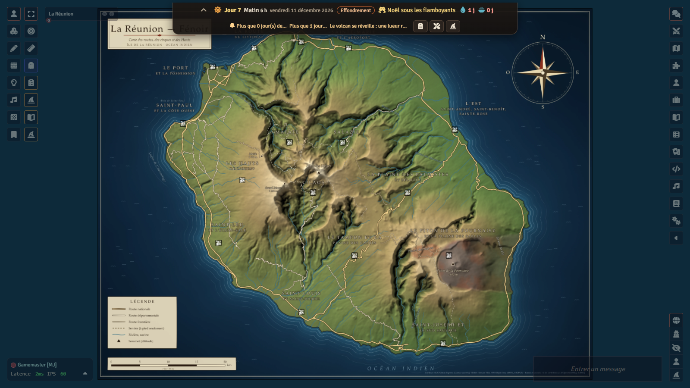
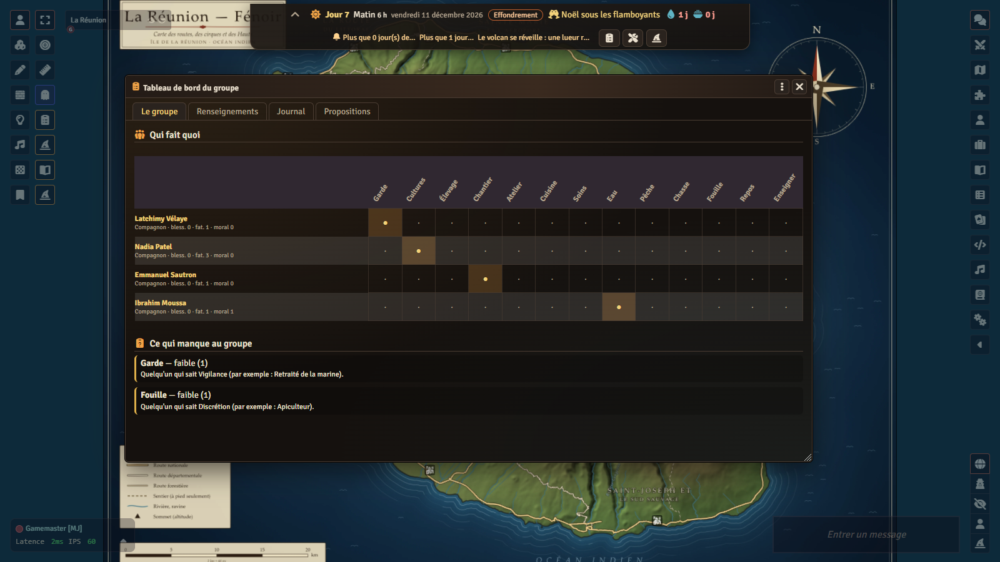
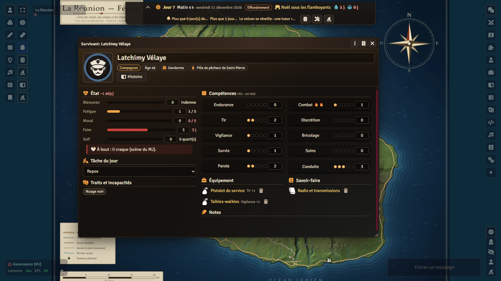
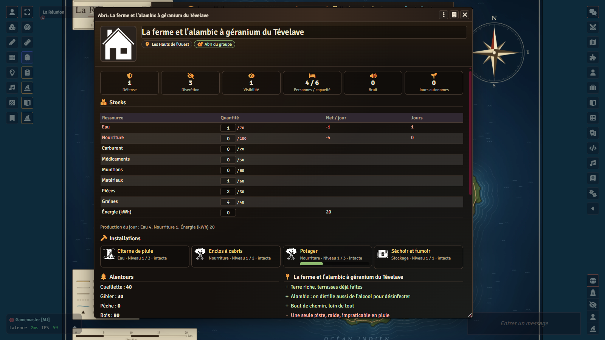
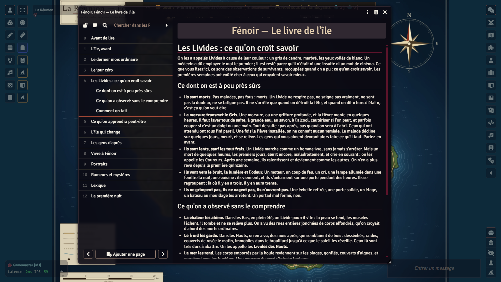

# Fénoir — survival on Réunion Island

*An original survival role-playing game for Foundry VTT: Réunion Island, on day zero of an unknown plague.*

**[Tutorial: from scratch to your first day of survival](TUTORIAL.md)** · [Version française](README.md) ·
[Changelog](CHANGELOG.md) · [Credits](modules/lakour-fenoir/CREDITS.md)

> **Transparency.** The code and texts of this repository were written with the help of an AI (Claude, by Anthropic) and
> reviewed by the author. The illustrations (world background, festival images, painted tokens) were generated locally by AI
> (FLUX.2 klein 9B model, no remote service). The island map is built by code from open data (IGN, OpenStreetMap); the
> fallback SVG tokens use icons from game-icons.net. Details in [Credits](#credits).

<p align="center">
  
  
</p>
<p align="center">
  
  
  
</p>

December, Réunion Island. The lychees are ripening, Christmas is being prepared under the filao trees, the radio mentions a
strange fever at the hospital. Tonight, someone you know did not get up the way they should. **Fénoir** ("the night", in
Réunion Creole: *i fé noir*): a sickness nobody can name, *the Grey*, raises the dead. They are called **the Pallid**. Your
characters live on the island and start **on day zero**: everything still works, nothing is right any more. The emergency
rooms overflow, the four-lane highway is jammed, the radio hesitates between two stories. Then, region after region, power,
water, fuel and phone go down; towns empty out or swarm; gangs form; the cyclones of the southern summer wait for nobody, and
neither does the volcano.

> **Language note.** The interface of the system and of the content module is available in **French and English**. The game
> content itself (guides, the Book of the Island, regions, installations, backgrounds, childhoods, traits, tables,
> festivals, and the registry the system reads) exists in both languages: `lakour-fenoir` is the French module;
> **`lakour-fenoir-en`** is the English edition, generated from the same sources and the translation dictionaries in
> `modules/lakour-fenoir/contenu/en/` (`npm run fabriquer-fenoir-en`). Same documents, same identifiers: enable only one of
> the two. Manifest: `releases/latest/download/lakour-fenoir-en.json`. Real place names stay in French; the game master
> (human or AI) can narrate in any language.

## In short

**Fénoir** is a complete, original game: its rules, texts, characters, factions, map and images are its own. *Nothing is
taken from The Walking Dead (TV series, comics, games), from Free League's role-playing game nor from any other zombie game*:
not a name, not an invented place, not a rule. The real geography of Réunion Island (towns, cirques, roads, trails, power
plants) is a fact, and it is named; buildings, occupants, characters and factions are invented, and no commercial brand is
mentioned. The survivor creation mechanics are inspired by *RimWorld* (coherent random draw, passions, traits) without
reusing any of its text or names.

It is played **in Foundry VTT**, online, as a campaign or a one-shot, and can be run two ways:

- **with a human GM**: the system keeps the clock, simulates the world, computes the shelter, resolves tests, assaults,
  diseases and building sites, and gives the GM a **window** where everything is one click away; the GM tells the story;
- **with the AI GM**: the game master is an AI (Claude or ChatGPT, with your own key) that runs the game with the system's
  tools; **AI companions** take seats in the group like players, and the **autopilot** lets the game go on with them alone.

Time moves **with your actions**, and the world moves with it. You must find a shelter, run it, and live off resources that
run out. Two paths, equally valid:

- **move on**: when the place is exhausted or untenable, relocate, carrying what you can, your skills and your
  **blueprints** (what you already knew how to build is rebuilt faster) — to a place that has changed since you last saw it;
- **put down roots**: cistern, vegetable garden, livestock, solar panels, pico-hydro, underground galleries… aim for
  **self-sufficiency**. But prosperity can be seen and heard: it draws gangs and hordes.

The island's twist: the humid heat of the lowlands breaks the Pallid down within months; the cool of the highlands and the
cirques preserves them. At first the highlands look safe and the coast is hell; months later, it is the other way round. The
"best place" changes with time: that is what drives relocations.

Tone: realistic, human survival, mutual aid and dilemmas, sober horror (no gratuitous gore); the beauty of the island as a
counterpoint (cirques, lagoon, December lychees, highland mist); a light touch of Creole, always understandable.

This repository holds five pieces:

| Piece | Folder | What it is |
|---|---|---|
| the **system** `lakour-survie` | `systems/lakour-survie/` | the rules (pure, tested logic), the clock and the world simulation, the sheets, creation, the banner, the dashboard, the GM window, the workshop, the vault |
| the **content module** `lakour-fenoir` | `modules/lakour-fenoir/` | Réunion Island: regions, shelter sites, roads, installations, know-how, backgrounds, childhoods, traits, equipment, recipes, diseases, factions, events, bestiary, festivals, guides, tables, maps |
| the **English module** `lakour-fenoir-en` | generated by `npm run fabriquer-fenoir-en` (not versioned) | the same documents, translated; only one of the two enabled at a time |
| the **empty world** `la-kour-fenoir` | `monde/` | a ready world: system, modules enabled, content installed, map in place |
| the **shared engine** `lakour-mj-ia` | `modules/lakour-mj-ia/` (submodule) | the AI GM, the companions, the encrypted vault that keeps the real world secret ([its repository](https://github.com/Hogun974/lakour-mj-ia)) |

The contract between the pieces: [`docs/survie-contrat.md`](docs/survie-contrat.md) (in French), with the design notes
[`docs/survie-notes-logique.md`](docs/survie-notes-logique.md) and [`docs/survie-notes-contenu.md`](docs/survie-notes-contenu.md).

## Who it is for, what you need

- **Solo**: one human with the AI GM, and AI companions if wanted (the engine's autopilot even lets the game go on with the
  companions alone). **As a group**: humans and a human GM, no AI at all. **Mixed**: 1 to 5 humans completed by AI
  companions, run by the AI GM or by a human GM.
- **Foundry VTT v14** (verified with 14.370). No game system to buy, no paid content: the system is provided here, with
  everything needed to play.
- The **AI GM module** (`lakour-mj-ia`, **0.46.0** or later, the submodule's version) is **required for the vault**: it
  seals the real state of the world (hordes, infestation, what is left to loot, what happened out of sight) and keeps it
  out of the players' browsers. Without an AI key it costs nothing and contacts nobody. Without the module, the system
  works, but the real world is kept in the clear in the world settings, and the GM is warned permanently ("players can
  read the state of the world").
- Optional: a Claude or OpenAI key for the AI GM, the companions and voice; Foundry's built-in A/V to talk.

## Installation

Three ways, from the simplest to the most complete. In all three you need **the system, the content module and the AI GM
module**. The [tutorial](TUTORIAL.md) walks through it all step by step, up to the first day of play.

### 1. From Foundry, with the manifests (recommended)

In Foundry's setup screen, **Game Systems › Install System**, then paste the manifest URL:

```
https://github.com/Hogun974/lakour-fenoir/releases/latest/download/system.json
```

Then **Add-on Modules › Install Module**, twice:

```
https://github.com/Hogun974/lakour-fenoir/releases/latest/download/module.json
https://github.com/Hogun974/lakour-mj-ia/releases/latest/download/module.json
```

To play in English, replace the first one with the English module (same documents, same identifiers; **only one of the two
enabled** in a world):

```
https://github.com/Hogun974/lakour-fenoir/releases/latest/download/lakour-fenoir-en.json
```

Then create a world with the **Fénoir — survie à La Réunion** system, enable both modules (**La Kour — Fénoir (English)**,
or **La Kour — Fénoir**, and **La Kour – MJ IA**), and accept the prompt to **install the content** (player guides, GM
journals, map of Réunion Island). Then: players create their survivor, the GM starts the game (GM window, or the AI GM's `survie_demarrer` tool).

### 2. A ready-made empty world

A world that is already configured (system, modules enabled, content installed, map of the island in place, a single
Gamemaster account without password) is published with each release, as an archive: Foundry 14 no longer installs a world
from a manifest URL (the **Game Worlds** tab only offers **Create World**).

1. First install the system and both modules from their manifests (way 1): the world requires them.
2. Download `la-kour-fenoir-en.zip` (English, `lakour-fenoir-en` enabled) or `la-kour-fenoir.zip` (French) from the
   [latest release](https://github.com/Hogun974/lakour-fenoir/releases/latest).
3. Unzip it into `Data/worlds/la-kour-fenoir-en/` (or `Data/worlds/la-kour-fenoir/`) inside Foundry's data folder
   (**Configuration › User Data Path**; on a hosting service, its file manager): `world.json` directly in that folder.
4. **Restart Foundry**: the world then appears in **Game Worlds**.

In both, the AI GM is set to the **Chronicler** personality, in validation mode, with a budget of 10 dollars per session.
The world is empty: no game, no player, no chronicle, no vault.

### 3. From source

```bash
git clone --recurse-submodules https://github.com/Hogun974/lakour-fenoir.git
cd lakour-fenoir
npm install                 # @foundryvtt/foundryvtt-cli and @resvg/resvg-js, pinned versions
npm run fabriquer-fenoir    # checks the content, writes src/ and assets/donnees.json, compiles the compendiums into packs/
npm run fabriquer-fenoir-en # optional: generates the English module modules/lakour-fenoir-en/
```

The compiled compendiums (`modules/lakour-fenoir/packs/`) **are not versioned**: they must be built. Then copy
`systems/lakour-survie/` to `Data/systems/lakour-survie/`, `modules/lakour-fenoir/` to `Data/modules/lakour-fenoir/`
(without `src/` and `contenu/`, which only serve the build) and `modules/lakour-mj-ia/` to `Data/modules/lakour-mj-ia/`
(without `essais/`, `outils/`, `docs/`, `package*.json`). `npm run empaqueter-paquets` produces the same archives as a
release, in `dist/`; `npm run empaqueter-monde` builds the empty world (`monde/dist/`).

## How it is played

**Time.** It is counted in **quarters** of six hours: morning, afternoon, evening, night. Searching a place takes a quarter;
exploring a region, one or two; travelling, depending on the road and the vehicle; building, depending on the site (work
quarters divided by the number of hands). Nothing moves until the group acts; each quarter, infection advances, thirst
weighs, noise dies down; each day, the shelter produces, the group eats and drinks, food spoils (5 % a day without a sealed
store or a drying shed: the humid heat rots everything), the world is simulated and its events fall. The game starts on
**4 December 2026** (GM setting): in the middle of the rainy and cyclone season (November to April); the southern winter
(May to October) is dry and cool, with frost above 1,500 m; lychees in December–January, mangoes from November to January,
foraging is better. The crisis has its **phases**: day zero (days 0–1), panic (2–6), collapse (7–20: power, water, fuel and
phone go down region by region, on days drawn in secret), silence (21–59), then the after (60+: the Pallid of the lowlands
decompose, gangs rule the coast, the highlands keep their old Pallid, slow and many).

**The test.** As many d6 as the skill level (0 to 5) + 1, plus a suitable tool or someone's help (+1), minus one's state
(wounds, fatigue, morale); every **5 or 6** is a success; normal 1 success, hard 2, extreme 3. You may **push** once (reroll
the failures, for 1 fatigue; a pushed failure brings a complication). A test that mattered, failed or pushed, gives a
**mark**; enough marks and the skill goes up. Ten skills: endurance, melee, shooting, stealth, vigilance, tinkering,
survival, medicine, speech, driving. A bite means an extreme medicine test within the quarter (wash, cauterise, sometimes
cut); otherwise the Grey is in, it advances every two quarters, and at the end the person dies and rises. No known cure.

**The shelter.** A site on the island (a Creole house, a school on the hill, a highland farm, a mountain lodge, an îlet of
Mafate, a lighthouse, a barracks, a lava tunnel…) with its capacity, defence, stealth, water, soil, sun, underground
potential, access, what you find on arrival and what is already there. You build **installations** in levels (barricades,
cistern, vegetable garden, panels, gallery…), each with its cost in materials, parts, seeds and work quarters, its
prerequisites (a know-how, water, soil, another installation) and its effects: production, defence, stealth, capacity,
visibility, noise, storage, cyclone protection, care, morale. The **shelter sheet** computes everything: stocks and days of
stock, net production, self-sufficiency (seven days in a row without searching where net water, food and energy are
positive), defence, stealth, visibility, capacity, building sites in progress, surroundings (foraging, game, fishing, wood,
which regenerate with the season), who does what. **Noise** (gunshot, generator, building site) drops by two per quarter;
**visibility** (lights at night, smoke, crops, size of the group) does not drop: at 3 people talk about you, at 5 scouts come
by, at 7 you get a visit, at 9 you get attacked. An **assault** pits the shelter's defence and the watch's vigilance against
the threat's strength: repelled, an installation damaged and someone wounded, or a **breach**.

**The two paths.** *Move on*: when the place runs dry, a horde approaches or the highland Pallid gather, you load what you can
(vehicle, donkey, kayak, or your arms), you keep your skills, your know-how and your **blueprints**: rebuilding elsewhere an
installation you have already built costs a quarter less materials and half the work. *Put down roots*: you dig, plant,
catch water, wire, until you depend on nothing; five **paths to self-sufficiency** are verified by the tests (the highland
farm, the îlet of Mafate, the house of the dry West, the Langevin valley with the river's current, the refuge under the farm
with its underground gallery and camouflage), in the rainy season as in the dry season. But a greenhouse that shines, a wind
turbine that creaks, smoke every evening tell the whole island there is something to take.

**Creation, RimWorld-style.** A survivor is a **childhood** (where and how they grew up), a **background** (what they did on
day zero), an **age** (16 to 75), 1 to 2 **passions** (🔥: marks count one and a half times or double, and morale follows),
1 to 3 character **traits** (never two incompatible ones), sometimes **incapacities** (violence, care, heavy work, driving…
in red on the sheet), and a **story**. The **Create a survivor** window (button of the actors bar, and on first load for a
player without a character) **draws** everything at random, coherently — skills are the sum of the modifiers of childhood,
background and traits —, then you **lock** what you keep (name, age, childhood, background, traits) and **reroll** the rest
as often as you like, or pick each element yourself. A **budget** (sum of levels between 10 and 16, GM setting) rules out
action heroes: ordinary people. First names and labels agree with gender. The AI GM then writes the "Story of…" journal (who
they are, their story, what they keep to themselves, the chapters of the campaign); without AI, the journal is created with
its questions. Six **pregens** are provided to start right away. At the shelter, everyone has a **task of the day** (watch,
crops, livestock, building, workshop, cooking, care, water, fishing, hunting, searching, rest, teaching); a task held for a
week gives a mark; the output of installations that need hands depends on who works there. **Recruits** fill what the group
lacks, with a reason to be there and a price; the GM (or automatic assignment) gives their task to companions and recruits.

**The spirit and the moral compass.** Every survivor has an **outlook** on the catastrophe (a trial, a chance to remake the
world, the will to live: what feeds their morale), one of the island's **religions** or an **anchor** (a photo, a notebook, a
routine, sport), practised or not, a **moral compass** from red (exclude, betray) to blue (welcome, help) that only they see
(others know it through their **reputation**), and **authority** when they lead. Nothing is magical: faith works through
morale, the game confirms nothing. The lower the morale, the more false noises the night adds; some don't hold on, and the
group holds them back by being there. Someone knocks at the door: the shelter shows what it truly lacks; the group welcomes,
refuses or betrays, may vote, and no colour comes free (blue draws refugees, red draws hard cases). A gang leader decides
according to their own compass (attack, negotiate, move on, issue an ultimatum, ask to join); a child witness imitates or
rebels; two groups split or merge. It is all run from the GM window's **Community** tab (`docs/survie-contrat.md` §14,
`docs/equilibre-moral.md`).

**Dated intelligence.** The island is divided into sixteen regions linked by real roads (RN1, RN2, the coastal road, the
Tamarins road, the Plaines road, the Cilaos road, the Salazie road, the Volcano road, the Lava road, and the trails of
Mafate, which has no road at all), each with its times on foot and by vehicle, and possible cuts (flooded fords, landslides,
swell, lava flow). What the group knows about a region is **dated intelligence**: seen with its own eyes on such a day, heard
on the radio, or mere rumour. The world changes while you are not there: infestation, looting by other survivors, factions
that grow and occupy abandoned shelters, hordes drawn by noise, cyclones (pre-alert, orange, red), eruption of the Fournaise.
**The GM (and the AI) see the real and the known; players only see the known, dated.** A relocation is planned on
intelligence that ages: that is the point.

**The windows.** The **survivor sheet** (skills — one click rolls a test —, passions, state, infection, diseases, traits,
incapacities, childhood and background, equipment, know-how, task of the day, "Story" button). The **shelter sheet**. The
**survival banner** at the top of the screen, for everyone, collapsible: day, moment, date, weather, phase, stocks in days,
alerts. The **group dashboard**: the members × tasks grid and the needs (covered, weak, missing), the dated intelligence and
the known map of the island, the log, the players' action proposals. The **workshop**: the possible recipes, and why not
the others. The **GM window**: start, advance time, make the group act, assaults, recruits, festivals, threats of the day to
resolve, and the real world (active GM only). The **Chronicles of Fénoir** keep the group's history. Scene lighting follows
the time of day, rain falls on the map, the screen shakes on an assault (client settings, honours `prefers-reduced-motion`),
the engine's ambient sounds follow night, rain, cyclone, tension; a soft chime signals "your turn".

The **player guide** (a world journal, readable by all) covers all of this in fourteen pages; **Life at the camp** describes
quiet time, its activities and its festivals; **The regions of the island** are pinned on the map; the **Book of the Island**
(thirteen pages, readable by all) tells the starting lore: the island before, the last ordinary month, day zero, what is
believed about the Pallid and what may be learnt, the island that changes, the people after, living in Fénoir, portraits,
rumours, a Creole glossary, and the first night.

## The content

All the content is in the `lakour-fenoir` module: twelve compendiums (folder "Fénoir"), plus the island's **registry**
(`assets/donnees.json`) the system loads to simulate the world. The real numbers, as `src/` holds them.

### Player guides (5 journals, 59 pages)

| Journal | Pages | What you read |
|---|---|---|
| **Fénoir — Player guide** | 14 | Welcome, the test, pushing and progressing, the ten skills, a survivor's state, time, resources and the shelter, noise, visibility and threats, travelling and knowing, moving on or putting down roots, creating your survivor, childhoods, backgrounds, traits. |
| **Life at the camp** | 3 | Quiet time, the eleven activities (teaching, repairing, farming, keeping watch, caring, storytelling, celebrating, cooking, fishing or hunting, resting, writing the chronicle) with their test and cost, celebrating. |
| **Fénoir — The Book of the Island** | 13 | The starting lore, written as a notebook passed from shelter to shelter (see above). |
| **The regions of the island** | 17 | The island, then one page per region, pinned on the map of Réunion. |
| **The festivals of Fénoir** | 12 | Celebrating anyway, then one illustrated page per festival. |

### GM journals (9 journals, 54 pages, hidden from players)

| Journal | Pages | What you read |
|---|---|---|
| **Fénoir — GM guide** | 7 | Running Fénoir, time that moves, the two paths, dated intelligence, tone and dilemmas, the GM's tools, factions in play. |
| **Chronology of the crisis** | 6 | Before day zero, then one page per phase. |
| **The factions of Fénoir** | 8 | One page per faction: leader, sign, what they want, how to deal with them. |
| **Bestiary of Fénoir** | 11 | Fighting, then one page per creature. |
| **Opening scenario — Day zero** | 9 | The first day, **seven starts** (Saint-Denis: the night shift; the West coast: fine weather; Le Port: the last freighter; the Cilaos road: the yellow bus; the Plaine des Cafres: the milk that does not go down; the East: the rain; Mafate: nothing happens), the first night. |
| **One-shot — The insulin of L'Entre-Deux** | 4 | The hook, the road, the pharmacist, the return and the end. |
| **Campaign — The Year of the Grey** | 6 | A campaign in **five fronts**: the Accountant, the provisional authority, the cold highlands, the Fournaise, the cure. |
| **Why the lowlands empty out** | 2 | The rule of the world and what it changes. |
| **Standing with the factions** | 1 | Tiers (Hostile −20, Wary −4, Neutral 0, Friendly 5, Allied 10) and clocks. |

### The island: 16 regions, 52 shelter sites, 25 links (registry)

Nine **coastal** regions (Saint-Denis; Sainte-Marie and the airport; the coastal road; Le Port and La Possession; Saint-Paul
and the West coast; Saint-Leu and L'Étang-Salé; Saint-Louis and Saint-Pierre; the East: Saint-André, Saint-Benoît,
Sainte-Rose), two **highland** regions (the Western highlands; Le Tampon and the Plaine des Cafres), two **forest** regions
(Saint-Joseph and the wild South; the Plaine des Palmistes and Bélouve), the **volcano** (the Piton de la Fournaise and the
Plaine des Sables) and the three **cirques** (Cilaos, Salazie, Mafate — no road). Each with its zone, altitude, population on
day zero, climate (sun and rain: the dry West, the very rainy East), lootable reserves, natural resources, the window in
which each network fails, its own dangers, starting factions, neighbours and their roads (with a slower alternative when
the main road is cut), and its marker on the map.

**52 shelter sites**, two to four per region: 7 farms, 7 plants and power stations, 5 harbours, 5 lodges, 4 Creole houses,
4 schools, 3 îlets, 2 barracks, 2 houses, 2 shops, 2 lava tunnels, a block of flats, a lighthouse, a hospital, a church and 5
places apart; each with capacity, defence, stealth, water (none, cistern, river, spring, well, mains), soil, sun,
underground, access, stocks on arrival, strengths and weaknesses, installations already there.

### Installations (36, in levels)

| Category | Installations (maximum level) |
|---|---|
| **Defence** (8) | Barricades (2), Palisade (2), Enclosure wall (3), Watchtower (2), Ditch and traps (2), Guard dogs (2), Armoured door (1), Camouflage (3) |
| **Water** (5) | Rain cistern (3), Sand and charcoal filter (2), Solar still (2), Spring catchment (2), Hand pump (2) |
| **Food** (8) | Vegetable garden (3), Greenhouse (2), Orchard (2), Poultry yard (2), Goat pen (2), Tilapia pond (2), Beehives (2), Compost (2) |
| **Energy** (5) | Solar panels (3), Batteries (3), River pico-hydro (2), Generator (1), Salvaged wind turbine (2) |
| **Living** (4) | Workshop (2), Infirmary (2), Dormitory (3), Common kitchen (1) |
| **Storage** (2) | Drying and smoking shed (1), Sealed store (2) |
| **Communication** (2) | Radio set (2), Antenna (1) |
| **Underground** (2) | Underground gallery (4: shored cellar, gallery, network, full refuge), Fitted lava tunnel (3) |

Benchmarks: a cistern gives 1 / 2 / 3 water a day per rain point of the region; a vegetable garden 2 / 4 / 6 food a day after
thirty days; panels 2 / 4 / 6 kWh a day per sun point; a group of four consumes 4 water and 4 food a day. Details are in
`docs/survie-notes-contenu.md`.

### Know-how (12), backgrounds (17), childhoods (22), traits (32)

- **Know-how**, kept from one shelter to the next: solar electricity, tropical market gardening, plumbing and filtration,
  masonry, mechanics, advanced first aid, lagoon and river fishing, animal husbandry, canning and drying, shoring and
  galleries, radio and transmissions, rural hydraulics. Each says how it is acquired (background, found book, taught by an
  NPC, a successful build) and what it allows.
- **Backgrounds** (the job on day zero): hospital nurse, electrician, fisherman of Saint-Gilles, cane planter, gendarme,
  student, canyon guide, mechanic, food-truck cook, retired navy man, highland farmer, paramedic, biology teacher, bazaar
  seller, yellow-bus driver, beekeeper, inhabitant of an îlet of Mafate; with modifiers, know-how, starting equipment,
  incapacities, hook and story lines.
- **Childhoods** (registry), from Réunion and elsewhere: child of the Salazie highlands, kid from Le Port, fisherman's
  daughter from Saint-Pierre, mainland childhood arrived at ten, child of the housing estates of Saint-Denis, childhood in
  Mayotte, in Madagascar, in Mauritius, child of a planter of the East, of an îlet of Mafate, of Le Tampon, of the West coast,
  of Cilaos, Chinese childhood of Saint-Denis, trading family of Saint-Pierre, soldier's child, childhood in care, sheltered
  childhood, child of the Plaine des Cafres, Tamil childhood of Saint-André, childhood on a boat, child of the wild South.
- **Traits** (registry), with original names (in French: *Doigts de terre*, *Sang de basalte*, *La main qui ne frappe pas*,
  *Peur des voûtes*, *Rat de galerie*, *Levé avant le coq*, *Oiseau de nuit*, *Ventre sans fond*, *Soleil dedans*, *Nuage
  noir*, *Cuir de cabri*, *Os de verre*, *Cœur de kour*, *Jambes de cabri*, *Peur de la mer*…), with their effects (skills,
  morale, fatigue, fears, needs, tasks, social) and their incompatibilities.

### Equipment and vehicles (49), recipes (21), diseases and injuries (12)

- **Equipment**: 8 weapons (cane cutlass, crowbar, bat, makeshift spear, speargun, hunting bow, makeshift crossbow, sheet-metal
  shield), 4 firearms (12-gauge shotgun, .22 rifle, service pistol, service rifle), 11 tools (pry bar, knife, flare gun,
  shovel and pick, toolbox, chainsaw, headlamp, binoculars, canyoning gear, snares and traps, alarm bells), 8 living items
  (filter bottle, stove, backpack, tent and tarp, jerrycans, mosquito nets, masonry stove, makeshift solar water heater),
  2 medical, 3 communication (walkie-talkies, crank radio, marine radio), 2 energy (portable panels, portable battery), a
  found manual, and **10 transports**: car, 4×4, flatbed truck, scooter, mountain bike, cargo bike, sea kayak, motor boat,
  pack donkey, horse of the Plaine des Cafres (seats, load, fuel per quarter, terrains, noise).
- **Workshop recipes**: spear, bow and arrows, crossbow, shield, snares and traps, alarm bells, filter bottle, wood stove,
  masonry stove, solar water heater, cargo bike, portable panels, crank radio, mosquito nets, reloaded ammunition,
  disinfecting alcohol, soap, bandages, herbal teas and poultices, jars and smoked meat, sorted seeds.
- **Diseases and injuries**: dengue, chikungunya, leptospirosis, gastroenteritis, scabies, infected wound, tetanus,
  fracture, burn, centipede sting, heatstroke, the shock of a loss; each with its course, its care and its prevention
  (treated water, mosquito nets, infirmary).

### People and beasts: pregens and NPCs (17), bestiary (10), factions (8)

- **Six pregens** (the tinkerer, the fighter, the grower, the scout, the leader, the healer) and **eleven named NPCs**:
  Commander Hoarau, Doctor Soundirassen, Brother Expédit, Gros Mani, the Accountant, Granny Lucette, skipper Grondin, the
  agent of the Rivière de l'Est, the elder of La Nouvelle, the radio amateur of Le Brûlé, Ti Zan the child.
- **Bestiary**: fresh Pallid, highland Pallid, drowned of the lagoon, burnt Pallid, Runner (the dead so fresh they still
  run), stray dog, feral pig, rats of the stores, Sans-Lune looter, Garrison soldier; dice, resistance, speed, senses, zones
  and phases, behaviour, weakness.
- **Factions**, all original: the Quay Garrison (the military remnant at the harbour, wary), the Plains Cooperative
  (neutral), the Scrappers (neutral), the Boats of the South (neutral), the Pilgrims of the Lava (wary), the Families of the
  Îlets (wary), the Dispensary of the South (friendly), the Sans-Lune (hostile); each with its growth, regions, what it
  wants, how to deal with it, a tiered **standing** kept by the engine's clocks, and a table of requests.

### Events (49) and GM tables (37)

- **Events** (registry): 16 weather (rains, cyclones, swell, drought…), 4 networks, 6 hordes, 8 human, 3 accidents, 4 at the
  shelter, 7 discoveries, 1 festival; the simulation draws their simple effects (road cut, stock lost, infestation, horde,
  faction), the GM tells the rest, with hints when the event hits the group's shelter.
- **Tables**: encounters by zone (coast, highlands, cirque, forest, volcano) and by phase (day zero, panic, collapse,
  silence, after), searches, complications, cyclones, radio rumours, radio calls, camp mishaps, rumour, site and survivor
  generators, story lines (the morning, a loved one), Creole first names and nicknames, reasons and prices of recruits, one
  table of requests per faction (8), one table per visibility tier (people talk about you, scouts, visit, assault).

### Maps (8) and tokens

The **map of Réunion Island** (scene, `assets/cartes/reunion.webp`, built by `outils/fabriquer-carte.mjs`: IGN outline,
relief, OpenStreetMap roads and trails) carries the markers of the sixteen regions, pinned to their pages. Seven **place
maps** drawn by the engine's shared renderer: the Creole house, the school, the lodge, the îlet, the petrol station, the
supermarket, the lava tunnel. The **tokens** (SVG, flat and raised, `outils/fabriquer-jetons-fenoir.mjs`): the pregens and
the NPCs, the bestiary, and extras (carer, refugee, pilgrim, fisherman, scrapper, farmer, child, sick person, dog…) to bring
a place to life.

## Festivals

The island celebrated a lot, and so does the camp. **Eleven** Réunion festivals, each with its illustrated journal and its
context line for the narrator (what the festival becomes in the world after): Christmas under the flame trees, New Year's
Eve and New Year's Day, Easter, All Saints and Halloween, the Music festival, 20 December (Freedom Day, abolition of
slavery), 14 July, Dipavali, Chinese New Year, Cavadee, the lychee festival. One rule only, never hidden: celebrating gives
back **1 morale** to everyone, once per festival, at the price of **one extra ration** per person. Festivals follow the
**game date** (setting "Festivals follow the game date": the AI GM's card of the day, decor and narrator line follow
Fénoir's calendar, not real life's), and the GM window offers the day's festival.

## The AI game master, in brief

The `lakour-mj-ia` module brings an **AI game master** (Claude or ChatGPT, with your own key, stored in your browser only)
and everything around it:

- a `lakour-survie` adapter and `survie_*` tools (state, advance, test, explore, search, settle, build, travel, relocate,
  adjust, wound, assault, intel, report, start): the AI runs the game with the system's rules, and its context always
  separates **what the players know** from **what only the GM knows**;
- **AI companions**: survivors played by the AI like players, with their childhood, background, traits and story; the
  **autopilot** when only they are left; **voice** and **listening**;
- the **encrypted vault** where the real world is sealed (AES-GCM 256) with a key that never leaves the active GM's browser,
  reopened from another browser with the players' key shares or a backup key; **without an AI key**, the vault still works;
- each character's story, the campaign notebook (contacts, standing clocks), seasonal festivals, ambient sounds;
- a **budget per session**, a "validation" mode where every sensitive action waits for the human GM's approval, and a
  **dummy** provider to try everything with no key and no cost.

The full guide is installed in the world by the module and can be read in [its repository](https://github.com/Hogun974/lakour-mj-ia).

### What engine 0.44.1 brings to the table

These features come from the shared engine and apply to all four La Kour worlds; they need `lakour-mj-ia` **0.44.1**
or later.

- **Players' cameras.** With Foundry's built-in audio and video (A/V), the GM allows or cuts every player's camera in
  one move: the **Players' cameras allowed** setting (*Settings › MJ IA*, checked by default), or the **Players'
  cameras** block of the AI GM console (wizard hat), shown as soon as the world's A/V is on. That block cuts or allows
  the cameras in one click, offers **Add video** when the world is audio only (the world switches to "Audio & Video",
  keeping the relay server, and everyone reloads the page) and **Give players the camera** when some lack the
  "Broadcast Video" permission (then granted to the Player role). Once cut, each player's camera is closed in their own
  browser and hidden in every other one: a player who switched it back on from their browser console is shown to no
  one. The GM keeps theirs, and **the microphone is never touched**. Without A/V, nothing changes.
- **AI companions model, from a list.** The *AI companions model* setting offers *Default* (empty: a cheap model from
  the active provider, Claude Haiku 5.5 at Anthropic or the cheapest of the list at OpenAI), the Claude models and the
  OpenAI models the engine knows. A model from another provider than the GM's falls back to the default; a name typed by
  hand with an older version is kept if recognised, otherwise replaced by the default.
- **Session cost, budget kept.** Every call is counted: narrator, AI companions, voice and transcription. The AI GM
  console shows the current session's estimated cost against the *Budget per session* (reopen it to see it up to
  date); once the budget is reached, the narrator stops and warns the GM, and the companions no longer call a model
  (they go on in simple mode, without AI). The estimate follows the prices recorded in the engine: the provider's bill
  is what counts, and an OpenAI model with an unknown price is flagged in the console (the budget then cannot count
  anything).
- **Autopilot.** When no **connected** player's survivor has a visible token left on the active scene, but AI
  companions do, the AI GM carries on alone, step by step: what the companions decide (search, watch, building, rest,
  travel) is resolved with the matching `survie_*` tool, which makes time pass, without choosing for them; out of
  combat, at most six exchanges with the companions before a pause. An offline player does not count. It needs a
  running session, *Autonomous* autonomy and the *Autopilot (companions only)* setting checked (the default); in
  approval mode, the empty world's, the GM only gets a notice. The autopilot hands control back as soon as a connected
  player returns, and stops at the budget, at the step limit (60 by default) or when the game no longer moves forward;
  the AI GM console stops or restarts it.

## Security

- **What a player sees.** Foundry sends the whole game world to every browser: settings, actors, journals, messages. The **real
  world** (hordes, outages, reserves, the random seed, diseases still incubating, the GM's secret notes on shelters) is
  therefore never there in clear: it is sealed in the vault of the `lakour-mj-ia` module. Without that module it stays in clear
  in the world settings (a warning reminds the GM): a curious player can read it. Survivor and shelter sheets are readable by
  everyone; a player only writes their survivor's name, portrait and notes, everything else goes through the GM (GM-only
  fields, checked by the Foundry server). Their tests only count when they answer a request from the GM.
- **An assistant GM is a GM.** Foundry gives them the same rights as the GM: they see and can do everything, vault included.
  Only give that role to someone who may know everything about the game.
- **The Gamemaster's password first.** The empty world has a Gamemaster account with no password: give it one (User
  Management) **before** inviting anyone, and a password to each player. Leave the random seed empty when starting a game: a
  safe seed is drawn.

## Languages

The **interface** of the system and of the module is in **French and English** (`lang/fr.json`, `lang/en.json`, every label
translated, world facts and alerts included). The **content texts** exist in both languages: the `lakour-fenoir` module is
the French one; `npm run fabriquer-fenoir-en` generates, from the same sources and the dictionaries
`modules/lakour-fenoir/contenu/en/<pack>.json` (plus `registre.json` for the registry's texts), the English module
**`lakour-fenoir-en`** (same documents, same identifiers; only one of the two enabled at a time; published manifest
`releases/latest/download/lakour-fenoir-en.json`). Glossary: *the Grey*, *the Pallid*; real places stay in French; the keys
the system reads never change. Method: `modules/lakour-mj-ia/docs/traduction.md`; `node outils/fabriquer-fenoir.mjs
--extraire` updates the dictionaries after a change of the sources.

## Tests

**257 Node tests** (`node --test`), no Foundry, no network, no cost, in a few seconds: the system's pure logic (dice, state,
time and resources, shelter, actions, generation, world simulation over 200 days with a fixed seed: nothing negative, hordes
in neighbouring regions, networks down within their window, decomposition of the lowlands after day 60, self-sufficiency
reachable), its localised texts, the content (every reference resolved, every region reachable from every other, every
installation coherent, the five paths to self-sufficiency in both seasons, no forbidden term), the translation (complete
dictionaries, the same world in English), and the Foundry layer on an in-memory double (`essais/doublures/foundry-survie.mjs`):
a complete game (day zero, generated survivors, settling, searching, cistern and garden, thirty days, assault, workshop,
disease, festival, recruit, relocation), secrets that never leak to players (settings, chat, public state, socket), sealing
and reopening the vault, the write guard outside the active GM, and mutation batteries (every broken key rule must be
caught).

```bash
npm run essais               # every test of the repository
npm run contrat              # the shared contract of content modules (extras, token index, plans)
npm run valider -- <folder containing common/ of Foundry v14>   # Foundry schemas, 0 errors expected
node outils/valider-modeles.mjs <folder containing common/ of Foundry v14>   # the content's "system" data against the system's models
```

The engine's tests: `cd modules/lakour-mj-ia && npm run essais`.

## Repository layout

```
systems/lakour-survie/        the system: logique/ (pure, tested in Node), scripts/ (Foundry, apps/), templates/, styles/, lang/
modules/lakour-fenoir/        the content module: contenu/*.mjs = source of truth (contenu/en/: English dictionaries);
                              src/ and assets/donnees.json built; packs/ compiled (not versioned); scripts/main.js =
                              installer and registry; scripts/fetes.js; CREDITS.md
modules/lakour-fenoir-en/     the English module, fully generated (not versioned)
modules/lakour-mj-ia/         submodule: the shared engine (AI GM, companions, vault, build and packaging tools)
monde/                        the empty world published with each release (world.json, src/; dist/ built)
outils/                       fabriquer-fenoir.mjs (content, compendiums, translation), fabriquer-carte.mjs (island map),
                              fabriquer-jetons-fenoir.mjs (SVG tokens), valider-modeles.mjs, empaqueter-paquets.mjs (archives)
essais/                       the Node tests of this repository, with their Foundry double
docs/                         survie-contrat.md (the contract between the pieces), survie-notes-logique.md, survie-notes-contenu.md,
                              publication.md, captures/
TUTORIEL.md, TUTORIAL.md      the "from scratch to your first day of survival" tutorial, in French and English
.github/workflows/            release.yml: release on v* tags
```

Useful scripts: `npm run fabriquer-fenoir` (content and compendiums), `npm run fabriquer-fenoir-en` (English module),
`npm run fabriquer-jetons-fenoir` (tokens), `npm run essais`, `npm run empaqueter-paquets`, `npm run empaqueter-monde`.

## Contributing

Feedback, bug reports and ideas are welcome in the [issues](https://github.com/Hogun974/lakour-fenoir/issues). To propose a
change:

- **content** is edited in `modules/lakour-fenoir/contenu/*.mjs` (never in `src/`, `packs/` or `assets/donnees.json`, which
  are built), then `npm run fabriquer-fenoir` and `npm run essais`; a new text is translated in `contenu/en/` after
  `node outils/fabriquer-fenoir.mjs --extraire`;
- the system's **logic** lives in `systems/lakour-survie/logique/`: pure functions, no Foundry, each with its tests;
  `scripts/` only wires them to Foundry;
- the **contract** `docs/survie-contrat.md` is the single source of truth for exchanges between the pieces: update it with
  the code;
- nothing specific to this game goes into the shared engine `lakour-mj-ia`, and nothing of the engine is fixed here (parity
  rule: an engine improvement serves every world that uses it);
- everything is in French (code, comments, texts), with interface labels translated into English;
- nothing taken from a published work or game: no text, no name, no invented place, no rule; no commercial brand in site
  names; a test rejects any forbidden term in the content.

## Credits

- Game, texts, rules, content and code: **Jordan (La Kour)**, written with the help of an AI (**Claude**, by Anthropic) and
  reviewed by the author.
- Painted tokens (`assets/jetons/ia/`, round WebP portraits used by the actors and the player tokens): generated locally by
  AI with FLUX.2 klein 9B (ComfyStudio, no remote service), without any game-icons.net icon.
- Silhouettes of the SVG tokens (fallback and relief version): icons from **[game-icons.net](https://game-icons.net)** (Caro Asercion, DarkZaitzev, Delapouite, Lorc,
  Skoll), **CC BY 3.0** licence, recoloured and set in a medallion; the icon-by-icon list is in
  [`modules/lakour-fenoir/CREDITS.md`](modules/lakour-fenoir/CREDITS.md).
- Map of Réunion Island (`assets/cartes/reunion.webp`): outline from **IGN Admin Express** (French open licence), relief
  from **AWS Open Data Terrain Tiles** (SRTM, ETOPO1), roads and trails **© OpenStreetMap contributors** (ODbL). The game's
  distances, durations and altitudes are approximations checked against public sources; they replace neither a map nor a
  guidebook.
- Illustrations (world background, festival images): **generated locally by AI by the author**, with the **FLUX.2 klein 9B**
  model (non-commercial model), without any remote service. Place maps: drawn by code by the shared engine. Ambient sounds:
  synthesised loops from the shared engine.
- **An original game**: nothing is taken from *The Walking Dead* (TV series, comics, games), from Free League's role-playing
  game, nor from any other zombie game or work. Survivor creation is inspired by *RimWorld*'s mechanics without reusing any
  of its text or names. The geography of Réunion Island is real; its inhabitants, buildings and factions are invented.

## Licence

- **The code** (the `lakour-survie` system, scripts, `lang/`, tools, tests, `docs/`): **MIT** licence, see
  [`LICENSE`](LICENSE) (© 2026 Hogun974).
- **Original texts and images** (guides, the Book of the Island, regions, factions, scenarios, tables: `contenu/` and its
  English dictionaries, the `src/` and `packs/` compendiums, the English module `lakour-fenoir-en`, the blank world
  `monde/`; illustrations, maps and tokens in `assets/`):
  [**CC BY-NC-SA 4.0**](https://creativecommons.org/licenses/by-nc-sa/4.0/) (attribution, non-commercial, share-alike).
  Expected attribution: "LaKour — Hogun974", with a link to this repository and to the licence. The illustrations come
  from a non-commercial AI model (FLUX.2 klein 9B), which rules out commercial use anyway.

The folder-by-folder details and the third-party notices are in [`LICENCE-CONTENU.md`](LICENCE-CONTENU.md); both files
ship in the system, module and world archives.

The game-icons.net icons keep their own CC BY 3.0 licence; the map keeps the licences of its sources (IGN open licence,
OpenStreetMap ODbL, whose attribution is mandatory). Foundry VTT is a trademark of Foundry Gaming LLC; this project is not
affiliated with it.
