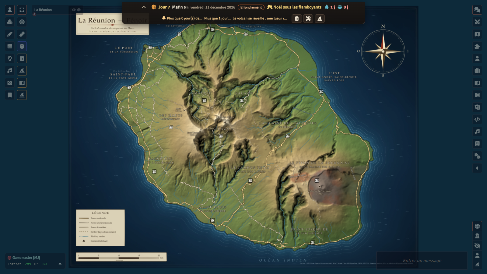
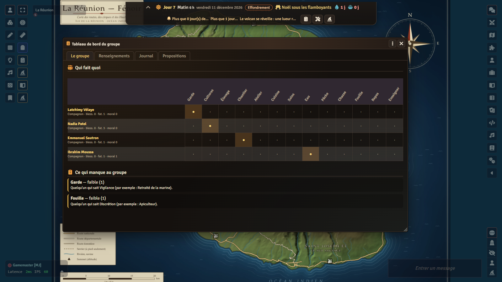
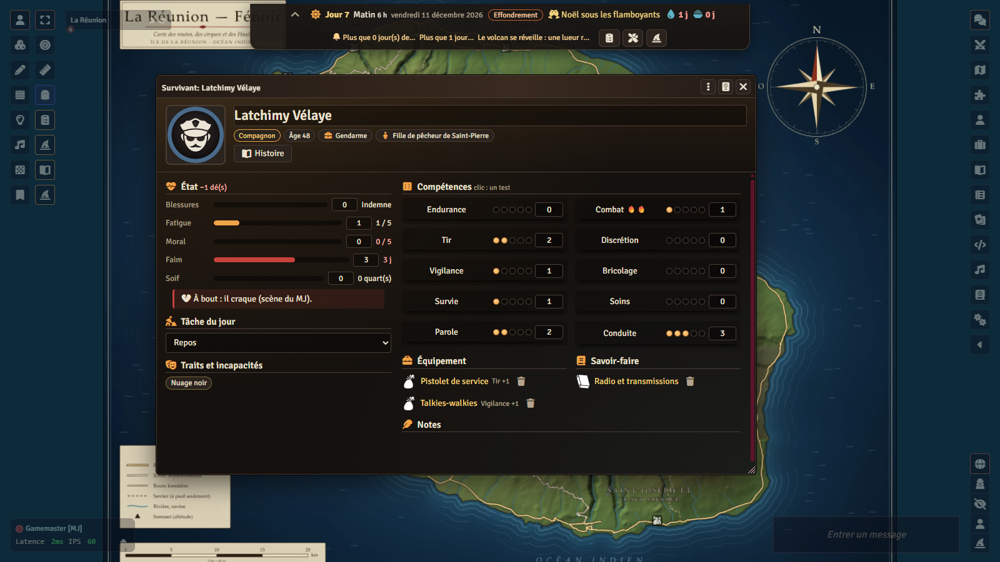
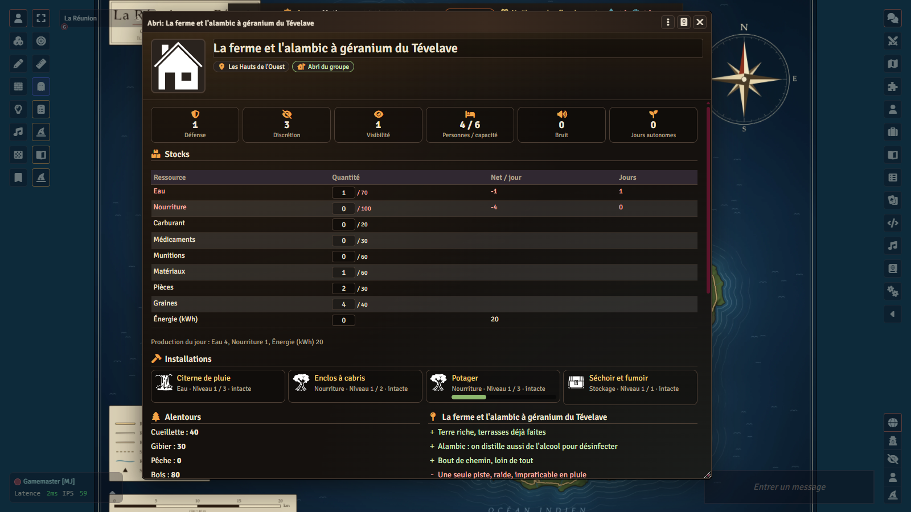
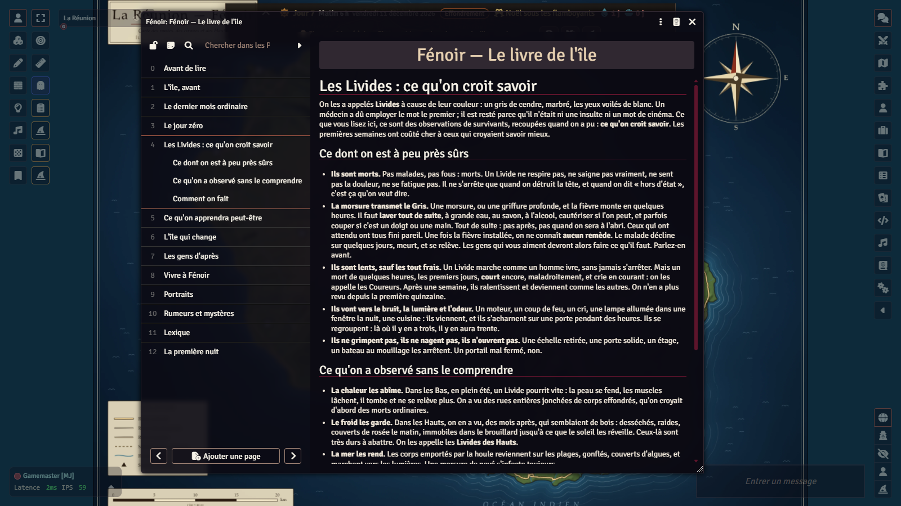

# Fénoir — survie à La Réunion

*Un jeu de rôle de survie original pour Foundry VTT : La Réunion, au jour zéro d'un mal inconnu.*

[English version](README.en.md) · [Changements](CHANGELOG.md) · [Crédits](modules/lakour-fenoir/CREDITS.md)

<p align="center">
  
  
</p>
<p align="center">
  
  
  
</p>

Décembre, La Réunion. Les letchis mûrissent, on prépare Noël sous les filaos, la radio parle d'une fièvre bizarre au CHU. Ce
soir, quelqu'un que vous connaissez ne s'est pas relevé comme il faut. **Fénoir** (« la nuit », en créole : *i fé noir*) :
un mal que personne ne sait nommer, *le Gris*, relève les morts. On les appelle les **Livides**. Vos personnages vivent sur
l'île et débarquent **au jour zéro** : tout marche encore, rien ne va plus. Les urgences débordent, la quatre-voies est
bouchée, la radio hésite entre deux versions. Puis, région par région, l'électricité, l'eau, le carburant et le téléphone
tombent ; les villes se vident ou grouillent ; des bandes s'organisent ; les cyclones de l'été austral n'attendent personne,
et le volcan non plus.

## En deux mots

**Fénoir** est un jeu complet et original : ses règles, ses textes, ses personnages, ses factions, sa carte et ses images
sont à lui. *Aucune reprise de The Walking Dead (série, bande dessinée, jeux), du jeu de rôle de Free League ni d'un autre
jeu de morts-vivants* : rien n'en est repris, ni un nom, ni un lieu inventé, ni une règle. La géographie réelle de La Réunion
(communes, cirques, routes, sentiers, centrales) est un fait, et on la nomme ; les bâtiments, les occupants, les personnages
et les factions sont inventés, et aucune marque commerciale n'est citée. La mécanique de création des survivants s'inspire de
celle de *RimWorld* (tirage cohérent, passions, traits) sans en reprendre ni texte ni nom.

Il se joue **dans Foundry VTT**, à distance, en campagne ou en one-shot, et se mène de deux façons :

- **avec un MJ humain** : le système tient l'horloge, simule le monde, calcule l'abri, résout les tests, les assauts, les
  maladies et les chantiers, et offre au MJ une **fenêtre** où tout se fait d'un clic ; le MJ raconte ;
- **avec le MJ IA** : le meneur est une IA (Claude ou ChatGPT, avec votre propre clé) qui mène la partie avec les outils du
  système ; des **compagnons IA** tiennent des places dans le groupe, comme des joueurs, et le **pilote automatique** laisse
  la partie continuer avec eux seuls.

Le temps avance **avec vos actions**, et le monde avance avec lui. Il faut trouver un abri, l'aménager, vivre de ressources
qui s'épuisent. Deux voies, aussi valables l'une que l'autre :

- **repartir** : quand l'endroit est épuisé ou intenable, déménager, en emportant ce qu'on peut porter, ses compétences et
  ses **plans** (ce qu'on a déjà su construire se reconstruit plus vite) — vers un lieu qui a changé depuis la dernière fois
  qu'on l'a vu ;
- **s'enraciner** : citerne, potager, élevage, panneaux solaires, pico-hydro, galeries souterraines… viser l'**autonomie**.
  Mais la prospérité se voit et s'entend : elle attire bandes et hordes.

Le twist de l'île : la chaleur humide des Bas défait les Livides en quelques mois, le frais des Hauts et des cirques les
garde. Au début, les Hauts semblent sûrs et le littoral est l'enfer ; des mois plus tard, c'est l'inverse. Le « meilleur
endroit » change avec le temps : c'est le moteur des déménagements.

Ton : survie réaliste et humaine, entraide et dilemmes, horreur sobre (pas de gore complaisant) ; la beauté de l'île en
contrepoint (cirques, lagon, letchis de décembre, brume des Hauts) ; du créole en touches légères, toujours compréhensible.

Ce dépôt contient quatre pièces :

| Pièce | Dossier | Ce que c'est |
|---|---|---|
| le **système** `lakour-survie` | `systems/lakour-survie/` | les règles (logique pure, éprouvée), l'horloge et la simulation du monde, les fiches, la création, le bandeau, le tableau de bord, la fenêtre du MJ, l'atelier, le coffre |
| le **module de contenu** `lakour-fenoir` | `modules/lakour-fenoir/` | La Réunion : régions, sites d'abri, routes, installations, savoir-faire, passés, enfances, traits, équipement, recettes, maladies, factions, événements, bestiaire, fêtes, guides, tables, cartes |
| le **module anglais** `lakour-fenoir-en` | engendré par `npm run fabriquer-fenoir-en` (non versionné) | les mêmes documents, traduits ; un seul des deux actif à la fois |
| le **monde vierge** `la-kour-fenoir` | `monde/` | un monde prêt : système, modules actifs, contenu installé, carte en place |
| le **moteur commun** `lakour-mj-ia` | `modules/lakour-mj-ia/` (sous-module) | le MJ IA, les compagnons, le coffre chiffré qui garde le monde réel secret ([son dépôt](https://github.com/Hogun974/lakour-mj-ia)) |

Le contrat entre les pièces : [`docs/survie-contrat.md`](docs/survie-contrat.md). Les choix de la logique :
[`docs/survie-notes-logique.md`](docs/survie-notes-logique.md) ; ceux du contenu : [`docs/survie-notes-contenu.md`](docs/survie-notes-contenu.md).

## Pour qui, avec quoi

- **En solo** : un humain avec le MJ IA, et des compagnons IA s'il le veut (le pilote automatique du moteur laisse même la
  partie continuer avec les seuls compagnons). **En groupe** : des humains et un MJ humain, sans aucune IA. **Mixte** : 1 à 5
  humains complétés par des compagnons IA, menés par le MJ IA ou par un MJ humain.
- **Foundry VTT v14** (vérifié avec la 14.370). Aucun système de jeu à acheter, aucun contenu payant : le système est fourni
  ici, et tout ce qu'il faut pour jouer avec.
- Le module **MJ IA** (`lakour-mj-ia`) est **requis pour le coffre** : c'est lui qui scelle l'état réel du monde (hordes,
  infestation, ce qui reste à piller, ce qui s'est passé hors de vue) et le garde hors des navigateurs des joueurs. Sans clé
  d'IA, il ne coûte rien et ne contacte personne. Sans lui, le système marche, mais le monde réel est gardé en clair dans les
  réglages du monde, et le MJ en est prévenu en permanence (« les joueurs peuvent lire l'état du monde »).
- Facultatif : une clé Claude ou OpenAI pour le MJ IA, les compagnons et la voix ; la voix intégrée de Foundry pour parler.

## Installation

Trois façons, de la plus simple à la plus complète. Dans les trois cas, il faut **le système, le module de contenu et le
module MJ IA**.

### 1. Depuis Foundry, par les manifestes (recommandé)

Dans la configuration de Foundry, **Systèmes de jeu › Installer un système**, puis coller l'adresse du manifeste :

```
https://github.com/Hogun974/lakour-fenoir/releases/latest/download/system.json
```

Puis **Modules › Installer un module**, deux fois :

```
https://github.com/Hogun974/lakour-fenoir/releases/latest/download/module.json
https://github.com/Hogun974/lakour-mj-ia/releases/latest/download/module.json
```

Pour jouer en anglais, remplacer le premier par le module anglais (mêmes documents, mêmes identifiants ; **un seul des deux
actif** dans un monde) :

```
https://github.com/Hogun974/lakour-fenoir/releases/latest/download/lakour-fenoir-en.json
```

Créer ensuite un monde avec le système **Fénoir — survie à La Réunion**, y activer les deux modules (**La Kour — Fénoir** et
**La Kour – MJ IA**), puis accepter l'invitation à **installer le contenu** (guides des joueurs, journaux du MJ, carte de
La Réunion). Puis : les joueurs créent leur survivant, le MJ démarre la partie (fenêtre du MJ, ou outil `survie_demarrer` du
MJ IA).

### 2. Un monde vierge, tout prêt

Un monde déjà configuré (système, modules actifs, contenu installé, carte de l'île en place, un seul compte Gamemaster sans
mot de passe) est publié avec chaque version. Dans **Mondes › Installer un monde**, coller :

```
https://github.com/Hogun974/lakour-fenoir/releases/latest/download/world.json
```

Le système et les modules sont proposés à l'installation s'ils manquent. Le monde est vierge : aucune partie, aucun joueur,
aucune chronique, aucun coffre.

### 3. Depuis les sources

```bash
git clone --recurse-submodules https://github.com/Hogun974/lakour-fenoir.git
cd lakour-fenoir
npm install                 # @foundryvtt/foundryvtt-cli et @resvg/resvg-js, versions épinglées
npm run fabriquer-fenoir    # vérifie le contenu, écrit src/ et assets/donnees.json, compile les compendiums dans packs/
npm run fabriquer-fenoir-en # facultatif : engendre le module anglais modules/lakour-fenoir-en/
```

Les compendiums compilés (`modules/lakour-fenoir/packs/`) **ne sont pas versionnés** : il faut les fabriquer. Copier ensuite
`systems/lakour-survie/` dans `Data/systems/lakour-survie/`, `modules/lakour-fenoir/` dans `Data/modules/lakour-fenoir/`
(sans `src/` ni `contenu/`, qui ne servent qu'à la fabrication) et `modules/lakour-mj-ia/` dans `Data/modules/lakour-mj-ia/`
(sans `essais/`, `outils/`, `docs/`, `package*.json`). `npm run empaqueter-paquets` produit les mêmes archives que la
publication, dans `dist/` ; `npm run empaqueter-monde` fabrique le monde vierge (`monde/dist/`).

## Comment on joue

**Le temps.** Il se compte en **quarts** de six heures : matin, après-midi, soir, nuit. Fouiller un lieu prend un quart ;
explorer une région, un ou deux ; voyager, selon la route et le véhicule ; construire, selon le chantier (quarts de travail
divisés par le nombre de bras). Rien n'avance tant que le groupe n'agit pas ; à chaque quart, l'infection progresse, la soif
pèse, le bruit retombe ; à chaque jour, l'abri produit, le groupe mange et boit, la nourriture se gâte (5 % par jour sans
réserve étanche ni séchoir : la chaleur humide pourrit tout), le monde se simule et ses événements tombent. La partie
commence le **4 décembre 2026** (réglage du MJ) : en pleine saison des pluies et des cyclones (novembre à avril) ; l'hiver
austral (mai à octobre) est sec et frais, il gèle au-dessus de 1 500 m ; letchis en décembre-janvier, mangues de novembre à
janvier, la cueillette est meilleure. La crise a ses **phases** : jour zéro (jours 0–1), panique (2–6), effondrement (7–20 :
électricité, eau, carburant et téléphone tombent région par région, à des jours tirés en secret), silence (21–59), puis
l'après (60 et plus : les Livides des Bas se décomposent, les bandes dominent le littoral, les Hauts gardent leurs vieux
Livides, lents et nombreux).

**Le test.** Autant de d6 que le niveau de la compétence (0 à 5) + 1, plus un outil adapté ou l'aide d'un autre (+1), moins
l'état (blessures, fatigue, moral) ; chaque **5 ou 6** est un succès ; normale 1 succès, difficile 2, extrême 3. On peut
**forcer** une fois (relancer les échecs, au prix d'1 fatigue ; un échec forcé donne une complication). Un test qui comptait,
échoué ou forcé, donne une **marque** ; assez de marques et la compétence monte. Dix compétences : endurance, combat, tir,
discrétion, vigilance, bricolage, survie, soins, parole, conduite. Une morsure, c'est un test de soins extrême dans le quart
(laver, cautériser, parfois couper) ; sinon le Gris est entré, il avance tous les deux quarts, et au bout la personne meurt et
se relève. Aucun remède connu.

**L'abri.** Un site de l'île (une case créole, un collège sur la colline, une ferme des Hauts, un gîte de montagne, un îlet de
Mafate, un phare, une caserne, un tunnel de lave…) avec sa capacité, sa défense, sa discrétion, son eau, son sol, son soleil,
son potentiel souterrain, son accès, ce qu'on y trouve en arrivant et ce qui y existe déjà. On y pose des **installations** en
niveaux (barricades, citerne, potager, panneaux, galerie…), chacune avec son coût en matériaux, pièces, graines et quarts de
travail, ses prérequis (un savoir-faire, de l'eau, du sol, une autre installation) et ses effets : production, défense,
discrétion, capacité, visibilité, bruit, stockage, protection cyclonique, soins, moral. La **fiche d'abri** calcule tout :
stocks et jours de stocks, production nette, autonomie (sept jours de suite sans fouille où eau, nourriture et énergie nettes
sont positives), défense, discrétion, visibilité, capacité, chantiers en cours, alentours (cueillette, gibier, pêche, bois, qui
se régénèrent avec la saison), qui fait quoi. Le **bruit** (coup de feu, groupe électrogène, chantier) retombe de deux par
quart ; la **visibilité** (lumières la nuit, fumée, cultures, taille du groupe) ne retombe pas : à 3 on parle de vous, à 5 des
éclaireurs passent, à 7 on vous rend visite, à 9 on vous attaque. Un **assaut** oppose la défense de l'abri et la vigilance de
la garde à la force de la menace : repoussé, une installation endommagée et un blessé, ou la **brèche**.

**Les deux voies.** *Repartir* : quand l'endroit s'épuise, qu'une horde approche ou que les Livides des Hauts se
rassemblent, on charge ce qu'on peut (véhicule, âne, kayak, ou ses bras), on garde ses compétences, ses savoir-faire et ses
**plans** : reconstruire ailleurs une installation qu'on a déjà bâtie coûte un quart de matériaux en moins et la moitié du
travail. *S'enraciner* : on creuse, on plante, on capte, on câble, jusqu'à ne plus dépendre de rien ; cinq **voies
d'autonomie** sont vérifiées par les essais (la ferme des Hauts, l'îlet de Mafate, la case de l'Ouest sec, la vallée de la
Langevin avec le courant de la rivière, le refuge sous la ferme avec sa galerie souterraine et son camouflage), en saison des
pluies comme en saison sèche. Mais une serre qui brille, une éolienne qui grince, une fumée chaque soir disent à toute l'île
qu'il y a quelque chose à prendre.

**La création, à la RimWorld.** Un survivant, c'est une **enfance** (où et comment il a grandi), un **passé** (ce qu'il faisait
au jour zéro), un **âge** (16 à 75 ans), 1 à 2 **passions** (🔥 : les marques comptent une fois et demie ou double, et le moral
suit), 1 à 3 **traits** de caractère (jamais deux incompatibles), parfois des **incapacités** (la violence, les soins, les
travaux lourds, la conduite… en rouge sur la fiche), et une **histoire**. La fenêtre **Créer un survivant** (bouton de la
barre des acteurs, et au premier chargement pour un joueur sans personnage) **tire** tout au sort de façon cohérente — les
compétences sont la somme des modificateurs de l'enfance, du passé et des traits —, puis on **verrouille** ce qu'on garde
(nom, âge, enfance, passé, traits) et on **relance** le reste autant qu'on veut, ou on choisit chaque élément. Un **budget**
(somme des niveaux entre 10 et 16, réglage du MJ) évite les héros de cinéma : des gens ordinaires. Les prénoms et les libellés
s'accordent au genre. Le MJ IA écrit ensuite le journal « Histoire de… » (qui il est, son histoire, ce qu'il garde pour lui,
les chapitres de la campagne) ; sans IA, le journal se crée avec ses questions. Six **prétirés** sont fournis pour commencer
tout de suite. À l'abri, chacun a une **tâche du jour** (garde, cultures, élevage, chantier, atelier, cuisine, soins, eau,
pêche, chasse, fouille, repos, enseigner) ; une tâche tenue une semaine donne une marque ; la production des installations qui
demandent des bras dépend de qui y travaille. Les **recrues** comblent ce qui manque au groupe, avec une raison d'être là et
un prix ; le MJ (ou la répartition automatique) donne leur tâche aux compagnons et aux recrues.

**Les renseignements datés.** L'île est découpée en seize régions reliées par des routes réelles (RN1, RN2, route du
Littoral, route des Tamarins, route des Plaines, route de Cilaos, route de Salazie, route du Volcan, route des Laves, et les
sentiers de Mafate, qui n'a pas de route du tout), chacune avec ses temps à pied et en véhicule, et des coupures possibles
(radiers en crue, éboulements, houle, coulée de lave). Ce que le groupe sait d'une région est un **renseignement daté** : vu
de ses yeux tel jour, entendu à la radio, ou simple rumeur. Le monde change pendant qu'on n'y est pas : infestation, pillage
par les autres survivants, factions qui grossissent et occupent les abris abandonnés, hordes attirées par le bruit, cyclones
(pré-alerte, orange, rouge), éruption de la Fournaise. **Le MJ (et l'IA) voient le réel et le connu ; les joueurs ne voient
que le connu, daté.** Un déménagement se prépare sur des renseignements qui vieillissent : c'est voulu.

**Les fenêtres.** La **fiche de survivant** (compétences — un clic lance un test —, passions, état, infection, maladies,
traits, incapacités, enfance et passé, équipement, savoirs, tâche du jour, bouton « Histoire »). La **fiche d'abri**. Le
**bandeau de survie** en haut de l'écran, chez tous, repliable : jour, moment, date, météo, phase, stocks en jours, alertes. Le
**tableau de bord du groupe** : la grille membres × tâches et les besoins (couvert, faible, manquant), les renseignements datés
et la carte connue de l'île, le journal, les propositions d'action des joueurs. L'**atelier** : les recettes possibles, et
pourquoi pas les autres. La **fenêtre du MJ** : démarrer, avancer le temps, faire agir le groupe, assauts, recrues, fêtes,
menaces du jour à résoudre, et le monde réel (au seul MJ actif). Les **chroniques de Fénoir** gardent l'histoire du groupe.
La lumière de la scène suit le moment, la pluie tombe sur la carte, l'écran tremble à un assaut (réglages client, respect de
`prefers-reduced-motion`), les ambiances sonores du moteur suivent la nuit, la pluie, le cyclone, la tension ; un tintement
discret signale « à toi ».

Le **guide du joueur** (journal du monde, lisible de tous) détaille tout cela en quatorze pages ; **La vie au camp** décrit
le temps calme, ses activités et ses fêtes ; **Les régions de l'île** sont épinglées sur la carte ; le **livre de l'île**
(treize pages, lisible de tous) raconte l'univers de départ : l'île avant, le dernier mois ordinaire, le jour zéro, ce qu'on
croit savoir des Livides et ce qu'on apprendra peut-être, l'île qui change, les gens d'après, vivre à Fénoir, des portraits,
des rumeurs, un lexique créole, et la première nuit.

## Le contenu

Tout le contenu est dans le module `lakour-fenoir` : douze compendiums (dossier « Fénoir »), plus le **registre** de l'île
(`assets/donnees.json`) que le système charge pour simuler le monde. Les vrais chiffres, tels que `src/` les contient.

### Les guides des joueurs (5 journaux, 59 pages)

| Journal | Pages | Ce qu'on y lit |
|---|---|---|
| **Fénoir — Guide du joueur** | 14 | Bienvenue, le test, forcer et progresser, les dix compétences, l'état d'un survivant, le temps, les ressources et l'abri, bruit, visibilité et menaces, voyager et savoir, repartir ou s'enraciner, créer son survivant, les enfances, les passés, les traits. |
| **La vie au camp** | 3 | Le temps calme, les onze activités (enseigner, réparer, cultiver, monter la garde, soigner, raconter, fêter, cuisiner, pêcher ou chasser, se reposer, écrire la chronique) avec leur test et leur coût, fêter. |
| **Fénoir — Le livre de l'île** | 13 | L'univers de départ, écrit comme un cahier qui circule d'abri en abri (voir ci-dessus). |
| **Les régions de l'île** | 17 | L'île, puis une page par région, épinglée sur la carte de La Réunion. |
| **Les fêtes de Fénoir** | 12 | Fêter quand même, puis une page illustrée par fête. |

### Les journaux du MJ (9 journaux, 54 pages, cachés aux joueurs)

| Journal | Pages | Ce qu'on y lit |
|---|---|---|
| **Fénoir — Guide du MJ** | 7 | Mener Fénoir, le temps qui avance, les deux voies, les renseignements datés, le ton et les dilemmes, les outils du MJ, les factions en jeu. |
| **Chronologie de la crise** | 6 | Avant le jour zéro, puis une page par phase. |
| **Les factions de Fénoir** | 8 | Une page par faction : chef, signe, ce qu'elle veut, comment traiter avec elle. |
| **Bestiaire de Fénoir** | 11 | Combattre, puis une page par créature. |
| **Scénario d'ouverture — Jour zéro** | 9 | Le premier jour, **sept départs** (Saint-Denis : la garde de nuit ; la côte Ouest : le grand beau temps ; Le Port : le dernier cargo ; la route de Cilaos : le car jaune ; la Plaine des Cafres : le lait qui ne descend pas ; l'Est : la pluie ; Mafate : rien ne se passe), la première nuit. |
| **One-shot — L'insuline de l'Entre-Deux** | 4 | L'accroche, la route, le pharmacien, le retour et la fin. |
| **Campagne — L'année du Gris** | 6 | Une campagne en **cinq fronts** : le Comptable, l'autorité provisoire, les Hauts froids, la Fournaise, le remède. |
| **Pourquoi les Bas se vident** | 2 | La règle du monde et ce qu'elle change. |
| **Réputation auprès des factions** | 1 | Paliers (Hostile −20, Méfiante −4, Neutre 0, Amicale 5, Alliée 10) et horloges. |

### L'île : 16 régions, 52 sites d'abri, 25 liaisons (registre)

Neuf régions de **littoral** (Saint-Denis ; Sainte-Marie et l'aéroport ; la route du Littoral ; Le Port et La Possession ;
Saint-Paul et la côte Ouest ; Saint-Leu et l'Étang-Salé ; Saint-Louis et Saint-Pierre ; l'Est : Saint-André, Saint-Benoît,
Sainte-Rose), deux des **Hauts** (les Hauts de l'Ouest ; Le Tampon et la Plaine des Cafres), deux de **forêt** (Saint-Joseph et
le Sud sauvage ; la Plaine des Palmistes et Bélouve), le **volcan** (le Piton de la Fournaise et la Plaine des Sables) et les
trois **cirques** (Cilaos, Salazie, Mafate — sans route). Chacune avec sa zone, son altitude, sa population au jour zéro,
son climat (soleil et pluie : l'Ouest sec, l'Est très pluvieux), ses réserves pillables, ses ressources naturelles, la
fenêtre où chaque réseau tombe, ses dangers propres, ses factions de départ, ses voisins et leurs routes (avec une variante
plus lente quand la route principale est coupée : chemin des Anglais, Dos d'Âne), et son repère sur la carte.

**52 sites d'abri**, deux à quatre par région : 7 fermes, 7 usines et centrales, 5 ports, 5 gîtes, 4 cases créoles, 4 écoles,
3 îlets, 2 casernes, 2 maisons, 2 commerces, 2 tunnels de lave, un immeuble, un phare, un hôpital, une église et 5 lieux à
part ; chacun avec capacité, défense, discrétion, eau (aucune, citerne, rivière, source, puits, réseau), sol, soleil,
souterrain, accès, stocks à l'arrivée, atouts et défauts, installations déjà là.

### Les installations (36, en niveaux)

| Catégorie | Installations (niveau maximal) |
|---|---|
| **Défense** (8) | Barricades (2), Palissade (2), Mur d'enceinte (3), Tour de guet (2), Fossé et pièges (2), Chiens de garde (2), Porte blindée (1), Camouflage (3) |
| **Eau** (5) | Citerne de pluie (3), Filtre à sable et charbon (2), Bouilleur solaire (2), Captage de source (2), Pompe manuelle (2) |
| **Nourriture** (8) | Potager (3), Serre (2), Verger (2), Basse-cour (2), Enclos à cabris (2), Bassin à tilapias (2), Ruches (2), Compost (2) |
| **Énergie** (5) | Panneaux solaires (3), Batteries (3), Pico-hydro sur rivière (2), Groupe électrogène (1), Éolienne de récupération (2) |
| **Vie** (4) | Atelier (2), Infirmerie (2), Dortoir (3), Cuisine commune (1) |
| **Stockage** (2) | Séchoir et fumoir (1), Réserve étanche (2) |
| **Communication** (2) | Poste radio (2), Antenne (1) |
| **Souterrain** (2) | Galerie souterraine (4 : cave étayée, galerie, réseau, refuge complet), Aménagement d'un tunnel de lave (3) |

Repères : une citerne donne 1 / 2 / 3 eau par jour et par point de pluie de la région ; un potager 2 / 4 / 6 nourriture par
jour après trente jours ; des panneaux 2 / 4 / 6 kWh par jour et par point de soleil ; un groupe de quatre consomme 4 eau et
4 nourriture par jour. Les détails sont dans `docs/survie-notes-contenu.md`.

### Savoir-faire (12), passés (17), enfances (22), traits (32)

- **Savoir-faire**, gardés d'un abri à l'autre : électricité solaire, maraîchage tropical, plomberie et filtration, maçonnerie,
  mécanique, premiers secours avancés, pêche au lagon et en rivière, élevage, conserverie et séchage, étaiement et galeries,
  radio et transmissions, hydraulique rurale. Chacun dit comment on l'acquiert (passé, livre trouvé, enseignement d'un PNJ,
  chantier réussi) et ce qu'il permet.
- **Passés** (le métier du jour zéro) : infirmière du CHU, électricien, pêcheur de Saint-Gilles, planteur de canne, gendarme,
  étudiante, guide de canyon, mécanicien, cuisinier de camion-bar, retraité de la marine, agricultrice des Hauts, ambulancier,
  professeure de SVT, vendeur de bazar, chauffeur de car jaune, apiculteur, habitant d'un îlet de Mafate ; avec modificateurs,
  savoirs, équipement de départ, incapacités, accroche et phrases d'histoire.
- **Enfances** (registre), réunionnaises et d'ailleurs : enfant des Hauts de Salazie, gamin du Port, fille de pêcheur de
  Saint-Pierre, enfance zoreil arrivée à dix ans, enfant de la cité à Saint-Denis, enfance à Mayotte, à Madagascar, à Maurice,
  enfant de planteur de l'Est, d'un îlet de Mafate, du Tampon, de la côte Ouest, de Cilaos, enfance chinoise de Saint-Denis,
  famille commerçante de Saint-Pierre, enfant de militaire, enfance en foyer, enfance protégée, enfant de la Plaine des
  Cafres, enfance tamoule de Saint-André, enfance sur un bateau, enfant du Sud sauvage.
- **Traits** (registre), aux noms originaux : Doigts de terre, Sang de basalte, La main qui ne frappe pas, Peur des voûtes,
  Rat de galerie, Levé avant le coq, Oiseau de nuit, Ventre sans fond, Mange comme un oiseau, Nuits blanches, Soleil dedans,
  Nuage noir, Cuir de cabri, Os de verre, Souffle court, Âme de pèlerin, Case à part, Cœur de kour, Tête de bois, Main
  ouverte, Doigts crochus, Ancien fumeur, Œil froid, Mains qui tremblent, Touche-à-tout, Bras tendu, Brute épaisse, Cœur
  d'artichaut, La langue de tout le monde, Jambes de cabri, Vertige, Peur de la mer ; avec leurs effets (compétences, moral,
  fatigue, peurs, besoins, tâches, social) et leurs incompatibilités.

### Équipement et véhicules (49), recettes (21), maladies et blessures (12)

- **Équipement** : 8 armes (sabre à canne, barre à mine, batte, lance de fortune, fusil-harpon, arc de chasse, arbalète de
  fortune, bouclier de tôle), 4 armes à feu (fusil de chasse calibre 12, carabine .22, pistolet de service, fusil d'assaut
  réglementaire), 11 outils (pied-de-biche, couteau, pistolet de détresse, pelle et pioche, caisse à outils, tronçonneuse,
  lampe frontale, jumelles, matériel de canyon, collets et nasses, cloches d'alerte), 8 objets de vie (gourde filtrante,
  réchaud, sac de randonnée, tente et bâche, jerricans, moustiquaires, poêle de masse, chauffe-eau solaire), 2 de soin,
  3 de communication (talkies, radio à manivelle, radio marine), 2 d'énergie (panneaux démontables, batterie nomade), un
  manuel trouvé, et **10 transports** : voiture, 4×4, camion plateau, scooter, vélo tout-terrain, vélo-cargo, kayak de mer,
  barque à moteur, âne de bât, cheval de la Plaine des Cafres (places, charge, carburant par quart, terrains, bruit).
- **Recettes de l'atelier** : lance, arc et flèches, arbalète, bouclier, collets et nasses, cloches d'alerte, gourde
  filtrante, réchaud à bois, poêle de masse, chauffe-eau solaire, vélo-cargo, panneaux démontables, radio à manivelle,
  moustiquaires, munitions rechargées, alcool désinfectant, savon, pansements, tisanes et emplâtres, bocaux et boucané,
  semences triées.
- **Maladies et blessures** : dengue, chikungunya, leptospirose, gastro-entérite, gale, plaie infectée, tétanos, fracture,
  brûlure, piqûre de scolopendre, coup de chaleur, le choc d'une perte ; chacune avec son évolution, ses soins et sa
  prévention (eau traitée, moustiquaires, infirmerie).

### Les gens et les bêtes : prétirés et PNJ (17), bestiaire (10), factions (8)

- **Six prétirés** (le bricoleur, la combattante, la cultivatrice, l'éclaireur, le meneur, la soignante) et **onze PNJ**
  nommés : la commandante Hoarau, la docteure Soundirassen, frère Expédit, Gros Mani, le Comptable, mémé Lucette, le patron
  Grondin, l'agent de la Rivière de l'Est, l'ancienne de La Nouvelle, la radioamatrice du Brûlé, Ti Zan l'enfant.
- **Bestiaire** : Livide frais, Livide des Hauts, Noyé du lagon, Livide brûlé, Coureur (les morts si frais qu'ils courent
  encore), chien errant, cochon marron, rats des réserves, pillard des Sans-Lune, soldat de la Garnison ; dés, résistance,
  vitesse, sens, zones et phases, comportement, faiblesse.
- **Factions**, originales : la Garnison du Quai (le reliquat militaire du port, méfiante), la Coopérative des Plaines
  (neutre), les Ferrailleurs (neutre), les Barques du Sud (neutre), les Pèlerins de la Lave (méfiante), les Familles des Îlets
  (méfiante), le Dispensaire du Sud (amicale), les Sans-Lune (hostile) ; chacune avec sa croissance, ses régions, ce qu'elle
  veut, comment traiter avec elle, une **réputation** à paliers tenue par les horloges du moteur, et une table de demandes.

### Les événements (49) et les tables du MJ (37)

- **Événements** (registre) : 16 de météo (pluies, cyclones, houle, sécheresse…), 4 de réseaux, 6 de hordes, 8 humains,
  3 accidents, 4 à l'abri, 7 découvertes, 1 de fête ; la simulation en tire les effets simples (route coupée, stock perdu,
  infestation, horde, faction), le MJ raconte le reste, avec des indications quand l'événement touche l'abri du groupe.
- **Tables** : rencontres par zone (littoral, Hauts, cirque, forêt, volcan) et par phase (jour zéro, panique, effondrement,
  silence, après), fouilles, complications, cyclones, rumeurs de la radio, appels radio, imprévus du camp, générateurs de
  rumeur, de site et de survivant, phrases d'histoire (le matin, un proche), prénoms et surnoms créoles, raisons et prix des
  recrues, une table de demandes par faction (8), une table par palier de visibilité (on parle de vous, éclaireurs, visite,
  assaut).

### Les cartes (8) et les jetons

La **carte de La Réunion** (scène, `assets/cartes/reunion.webp`, fabriquée par `outils/fabriquer-carte.mjs` : contour IGN,
relief, routes et sentiers OpenStreetMap) porte les repères des seize régions, épinglés sur leurs pages. Sept **cartes de
lieux** dessinées par le rendu commun du moteur : la case créole, le collège, le gîte, l'îlet, la station-service, le
supermarché, le tunnel de lave. Les **jetons** (SVG, plats et en relief, `outils/fabriquer-jetons-fenoir.mjs`) : les
prétirés et les PNJ, le bestiaire, et des figurants (soignant, réfugié, pèlerin, pêcheur, ferrailleur, fermier, enfant,
malade, chien…) pour animer un lieu.

## Les fêtes

L'île fêtait beaucoup, et le camp aussi. **Onze fêtes** réunionnaises, chacune avec son journal illustré et sa ligne de
contexte pour le narrateur (ce que la fête devient dans le monde d'après) : Noël sous les flamboyants, la Saint-Sylvestre et
le jour de l'an, Pâques, la Toussaint et Halloween, la fête de la musique, le 20 décembre (fête de la liberté, abolition de
l'esclavage), le 14 juillet, Dipavali, le Nouvel An chinois, le Cavadee, la fête des letchis. Une seule règle, jamais cachée :
fêter redonne **1 de moral** à chacun, une fois par fête, au prix d'**une ration de plus** par personne. Les fêtes suivent la
**date de jeu** (réglage « Les fêtes suivent la date de jeu » : la carte du jour, le décor et la ligne du narrateur du MJ IA
suivent le calendrier de Fénoir, pas celui de la vraie vie), et la fenêtre du MJ propose celle du jour.

## Le MJ IA, en bref

Le module `lakour-mj-ia` apporte un **meneur IA** (Claude ou ChatGPT, avec votre propre clé, rangée dans votre navigateur
seulement) et tout ce qui va avec :

- un adaptateur `lakour-survie` et des outils `survie_*` (état, avancer, test, explorer, fouiller, installer, construire,
  voyager, déménager, ajuster, blessure, assaut, renseigner, bilan, démarrer) : l'IA mène la partie avec les règles du
  système, et son contexte sépare toujours **ce que les joueurs savent** de **ce que le MJ seul sait** ;
- des **compagnons IA** : des survivants joués par l'IA comme des joueurs, avec leur enfance, leur passé, leurs traits et
  leur histoire ; le **pilote automatique** quand il ne reste qu'eux ; la **voix** et l'**écoute** ;
- le **coffre chiffré** où le monde réel est scellé (AES-GCM 256) avec une clé qui ne quitte pas le navigateur du MJ actif,
  rouverte depuis un autre navigateur par les parts de clé des joueurs ou une clé de secours ; **sans clé d'IA**, le coffre
  marche quand même ;
- l'histoire de chaque personnage, le Carnet de campagne (contacts, horloges de réputation), les fêtes de saison, les
  ambiances sonores ;
- un **budget par séance**, un mode « validation » où chaque action sensible attend l'accord du MJ humain, et un fournisseur
  **factice** pour tout essayer sans clé ni coût.

Le guide complet est installé dans le monde par le module et se lit dans [son dépôt](https://github.com/Hogun974/lakour-mj-ia).

## Sécurité

- **Ce que voit un joueur.** Foundry envoie à chaque navigateur tout le monde de jeu : réglages, acteurs, journaux, messages.
  Le **monde réel** (hordes, coupures, réserves, graine du hasard, maladies en incubation, notes secrètes du MJ sur les abris)
  n'y est donc jamais en clair : il est scellé dans le coffre du module `lakour-mj-ia`. Sans ce module, il reste en clair dans
  les réglages du monde (un avertissement le rappelle au MJ) : un joueur curieux peut le lire. Les fiches de survivant et
  d'abri sont, elles, lisibles de tous ; un joueur n'écrit sur son survivant que son nom, son portrait et ses notes, le reste
  passe par le MJ (champs réservés au MJ, vérifiés par le serveur de Foundry). Ses tests ne comptent que s'ils répondent à une
  demande du MJ.
- **Un MJ-assistant est un MJ.** Foundry lui donne les mêmes droits qu'au MJ : il voit et peut tout, coffre compris. Ne donnez
  ce rôle qu'à quelqu'un qui peut tout savoir de la partie.
- **Le mot de passe du Gamemaster d'abord.** Le monde vierge a un compte Gamemaster sans mot de passe : donnez-lui-en un
  (Configuration des joueurs) **avant** d'inviter qui que ce soit, et un mot de passe à chaque joueur. Laissez vide la graine
  du hasard au démarrage d'une partie : une graine sûre est tirée.

## Langues

L'**interface** du système et du module est en **français et en anglais** (`lang/fr.json`, `lang/en.json`, tout libellé
traduit, faits et alertes du monde compris). Les **textes du contenu** (guides, livre de l'île, régions, installations,
passés, enfances, traits, tables, fêtes, et le registre que le système lit) existent dans les deux langues : le module
`lakour-fenoir` est le français ; `npm run fabriquer-fenoir-en` engendre, des mêmes sources et des dictionnaires
`modules/lakour-fenoir/contenu/en/<pack>.json` (plus `registre.json` pour les textes du registre), le module anglais
**`lakour-fenoir-en`** (mêmes documents, mêmes identifiants ; un seul des deux actif à la fois ; manifeste publié
`releases/latest/download/lakour-fenoir-en.json`). Glossaire : *the Grey*, *the Pallid* ; les lieux réels restent en
français ; les clés que le système lit ne changent jamais. Méthode : `modules/lakour-mj-ia/docs/traduction.md` ;
`node outils/fabriquer-fenoir.mjs --extraire` met les dictionnaires à jour après un changement des sources. Le meneur (humain
ou IA) peut raconter dans n'importe quelle langue.

## Essais

**209 essais** Node (`node --test`), sans Foundry, sans réseau ni coût, en quelques secondes, couvrent la logique pure du
système (dés, état, temps et ressources, abri, actions, génération, simulation du monde sur 200 jours à graine fixe :
rien de négatif, hordes dans des régions voisines, réseaux tombés dans leur fenêtre, décomposition des Bas après le jour 60,
autonomie atteignable), ses textes localisés, le contenu (toutes les références résolues, chaque région atteignable de
toutes les autres, chaque installation cohérente, les cinq voies d'autonomie dans les deux saisons, aucun terme interdit), la
traduction (dictionnaires complets, même monde en anglais), et la couche Foundry sur une doublure en mémoire
(`essais/doublures/foundry-survie.mjs`) : une partie complète (jour zéro, survivants tirés au générateur, installation,
fouille, citerne et potager, trente jours, assaut, atelier, maladie, fête, recrue, déménagement), le secret qui ne fuit
jamais vers les joueurs (réglages, chat, état public, socket), le scellement et la réouverture du coffre, la garde d'écriture
hors du MJ actif, et des batteries de mutations (chaque règle clé cassée doit être détectée).

```bash
npm run essais               # tous les essais du dépôt
npm run contrat              # le contrat commun des modules de contenu (figurants, index des jetons, plans)
npm run valider -- <dossier contenant common/ de Foundry v14>   # schémas Foundry, 0 erreur attendue
node outils/valider-modeles.mjs <dossier contenant common/ de Foundry v14>   # les données « system » du contenu contre les modèles
```

Les essais du moteur : `cd modules/lakour-mj-ia && npm run essais`.

## Structure du dépôt

```
systems/lakour-survie/        le système : logique/ (pure, éprouvée en Node), scripts/ (Foundry, apps/), templates/, styles/, lang/
modules/lakour-fenoir/        le module de contenu : contenu/*.mjs = source de vérité (contenu/en/ : dictionnaires anglais) ;
                              src/ et assets/donnees.json fabriqués ; packs/ compilés (non versionnés) ; scripts/main.js =
                              installateur et registre ; scripts/fetes.js ; CREDITS.md
modules/lakour-fenoir-en/     le module anglais, engendré en entier (non versionné)
modules/lakour-mj-ia/         sous-module : le moteur commun (MJ IA, compagnons, coffre, outils de fabrication et d'empaquetage)
monde/                        le monde vierge publié avec chaque version (world.json, src/ ; dist/ fabriqué)
outils/                       fabriquer-fenoir.mjs (contenu, compendiums, traduction), fabriquer-carte.mjs (carte de l'île),
                              fabriquer-jetons-fenoir.mjs (jetons SVG), valider-modeles.mjs, empaqueter-paquets.mjs (archives)
essais/                       les essais Node de ce dépôt, avec leur doublure de Foundry
docs/                         survie-contrat.md (le contrat entre les pièces), survie-notes-logique.md, survie-notes-contenu.md,
                              publication.md, captures/
.github/workflows/            release.yml : publication sur étiquette v*
```

Scripts utiles : `npm run fabriquer-fenoir` (contenu et compendiums), `npm run fabriquer-fenoir-en` (module anglais),
`npm run fabriquer-jetons-fenoir` (jetons), `npm run essais`, `npm run empaqueter-paquets`, `npm run empaqueter-monde`.

## Contribuer

Les retours, rapports de bogue et idées sont les bienvenus dans les [issues](https://github.com/Hogun974/lakour-fenoir/issues).
Pour proposer un changement :

- le **contenu** se modifie dans `modules/lakour-fenoir/contenu/*.mjs` (jamais dans `src/`, `packs/` ni `assets/donnees.json`,
  qui sont fabriqués), puis `npm run fabriquer-fenoir` et `npm run essais` ; un texte nouveau se traduit dans
  `contenu/en/` après `node outils/fabriquer-fenoir.mjs --extraire` ;
- la **logique** du système est dans `systems/lakour-survie/logique/` : des fonctions pures, sans Foundry, chacune avec ses
  essais ; `scripts/` ne fait que les brancher à Foundry ;
- le **contrat** `docs/survie-contrat.md` est la seule source de vérité des échanges entre les pièces : le mettre à jour
  avec le code ;
- rien de propre à ce jeu ne va dans le moteur commun `lakour-mj-ia`, et rien du moteur ne se corrige ici (règle de parité :
  une amélioration du moteur sert à tous les mondes qui l'utilisent) ;
- tout est en français (code, commentaires, textes), avec les libellés d'interface traduits en anglais ;
- aucune reprise d'une œuvre ou d'un jeu édité : ni texte, ni nom, ni lieu inventé, ni règle ; aucune marque commerciale
  dans les noms de sites ; un essai refuse d'ailleurs tout terme interdit dans le contenu.

## Crédits

- Jeu, textes, règles, contenu et code : **Jordan (La Kour)**, avec l'aide d'assistants de programmation.
- Silhouettes des jetons : icônes de **[game-icons.net](https://game-icons.net)** (Caro Asercion, DarkZaitzev, Delapouite,
  Lorc, Skoll), licence **CC BY 3.0**, recolorées et composées dans un médaillon ; la liste icône par icône est dans
  [`modules/lakour-fenoir/CREDITS.md`](modules/lakour-fenoir/CREDITS.md).
- Carte de La Réunion (`assets/cartes/reunion.webp`) : contour **IGN Admin Express** (licence ouverte), relief **Terrain Tiles**
  d'AWS Open Data (SRTM, ETOPO1), routes et sentiers **© les contributeurs d'OpenStreetMap** (ODbL). Les distances, durées et
  altitudes du jeu sont des approximations vérifiées sur des sources publiques ; elles ne remplacent ni une carte ni un guide.
- Illustrations (fond du monde, images des fêtes) : **générées localement par IA par l'auteur**, avec le modèle **FLUX.2 klein
  9B** (modèle non commercial), sans service distant. Cartes de lieux : dessinées par programme par le moteur commun. Sons
  d'ambiance : boucles synthétisées du moteur commun.
- **Jeu original** : aucune reprise de *The Walking Dead* (série, bande dessinée, jeux), du jeu de rôle de Free League, ni
  d'un autre jeu ou d'une autre œuvre de morts-vivants. La création des survivants s'inspire de la mécanique de *RimWorld*
  sans en reprendre ni texte ni nom. La géographie de La Réunion est réelle ; ses habitants, ses bâtiments et ses factions
  sont inventés.

## Licence

> **TODO (Jordan)** : choisir et confirmer la licence avant le passage en public, puis la rappeler dans `CREDITS.md`, dans
> `monde/world.json` et dans le champ `license` des manifestes. Aucun fichier `LICENSE` n'est encore créé : tant qu'il n'y en
> a pas, le dépôt est « tous droits réservés » par défaut.

Deux options sont envisagées :

- **le code** (système, scripts, outils) sous licence **MIT** ;
- **les textes et les images** (guides, livre de l'île, régions, factions, scénarios, tables, illustrations) sous
  **CC BY-NC-SA 4.0** (attribution, pas d'usage commercial, partage dans les mêmes conditions) — les illustrations sont
  issues d'un modèle d'IA non commercial, ce qui exclut de toute façon un usage commercial.

Les icônes de game-icons.net restent sous leur propre licence CC BY 3.0 ; la carte garde les licences de ses sources (licence
ouverte de l'IGN, ODbL d'OpenStreetMap, dont l'attribution est obligatoire). Foundry VTT est une marque de Foundry Gaming LLC ;
ce projet n'y est pas affilié.
