# Tutorial — from scratch to your first day of survival

*Install Fénoir in Foundry VTT, create your survivors, find a shelter and get through the first day. Allow an hour,
installation included.*

[Version française](TUTORIEL.md) · [README](README.en.md) · [The AI GM engine tutorial](https://github.com/Hogun974/lakour-mj-ia/blob/principale/TUTORIAL.md)

This tutorial assumes you have never heard of Fénoir. It follows the order of a real first evening: install, prepare the
world, create the survivors, start, take shelter, play the day, then (if you wish) hand the narration over to the AI GM. The
full rules are in the game itself (the **Fénoir — Player's guide** journal); here we only keep what you need to get going.

> The screenshots referred to (`docs/captures/…`) are listed in [`docs/captures/LISEZ-MOI.md`](docs/captures/LISEZ-MOI.md);
> the `.en.png` ones show the English interface.

## Contents

1. [What you need](#1-what-you-need)
2. [Install the system, the module and the engine](#2-install-the-system-the-module-and-the-engine)
3. [The world: ready-made, or your own](#3-the-world-ready-made-or-your-own)
4. [Before you invite anyone](#4-before-you-invite-anyone)
5. [Create the survivors](#5-create-the-survivors)
6. [Start the game](#6-start-the-game)
7. [The shelter](#7-the-shelter)
8. [The first day: tasks, stocks, expeditions, radio](#8-the-first-day-tasks-stocks-expeditions-radio)
9. [The AI GM as narrator (optional)](#9-the-ai-gm-as-narrator-optional)
10. [Voice and the TURN audio relay (optional)](#10-voice-and-the-turn-audio-relay-optional)
11. [Troubleshooting](#11-troubleshooting)

## 1. What you need

- **Foundry VTT v14**, with a licence. Fénoir is verified with **14.370**; a later v14 should work, v13 will not.
- A Foundry server your players can reach (at home with the port open, or with a host). To try it alone, Foundry on your
  own computer is enough.
- **Nothing to buy**: the game system, the content and the AI GM engine are free and provided here.
- Optional: a Claude (Anthropic) or OpenAI API key for the AI GM. **Without a key, the whole game works**: you run the game
  yourself, and the engine contacts no one.

Fénoir comes as **three packages** to install, plus a world:

| Package | Id | Role |
|---|---|---|
| System *Fénoir — survie à La Réunion* | `lakour-survie` | the rules, the sheets, time, the world simulation |
| Module *La Kour — Fénoir* | `lakour-fenoir-en` (English) or `lakour-fenoir` (French) | the content: the island, shelters, installations, guides |
| Module *La Kour – MJ IA* | `lakour-mj-ia` (**0.44.1** or later) | the vault that keeps the real world secret, and the AI GM if you want it |

The interface of the system is in English and French (it follows Foundry's language); the English content module holds
the translated guides, regions and tables. Real place names (Saint-Denis, Cilaos, Mafate…) stay in French.

The AI GM module is **needed even without AI**: it encrypts the real state of the world (hordes, supplies, outages…) so
that players cannot read it in their browser. Without it the game runs, but the GM is permanently warned that players can
read the state of the world.

## 2. Install the system, the module and the engine

Everything is installed from Foundry's setup screen (before entering a world) by pasting a **manifest URL**. Foundry then
finds updates on its own.

**The system.** **Game Systems › Install System** tab, *Manifest URL* field:

```
https://github.com/Hogun974/lakour-fenoir/releases/latest/download/system.json
```

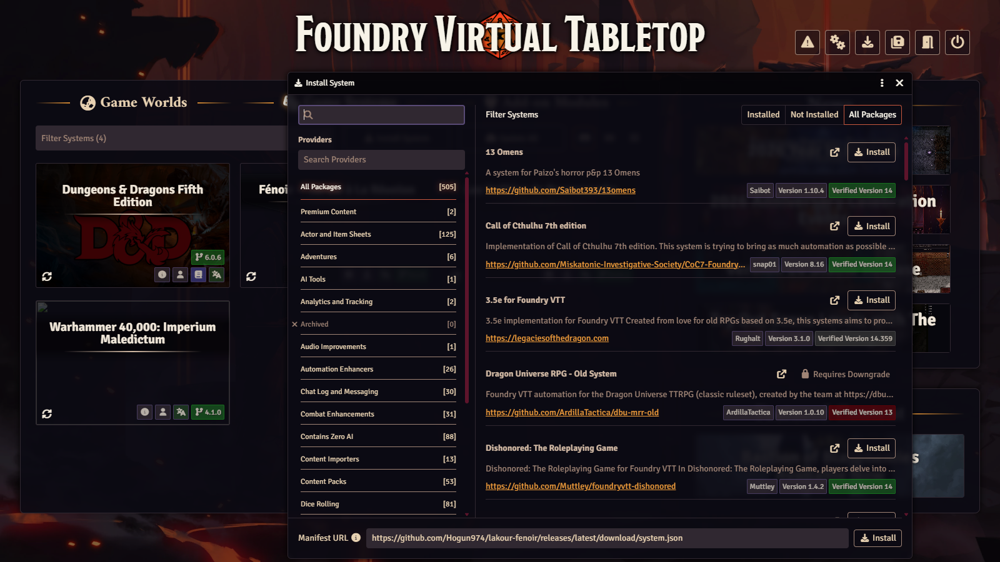

**The English content module.** **Add-on Modules › Install Module**, same field:

```
https://github.com/Hogun974/lakour-fenoir/releases/latest/download/lakour-fenoir-en.json
```

The French module (`.../module.json`) has the same documents and the same ids: **only one of the two may be active** in a
world.

**The AI GM engine.** **Install Module** again:

```
https://github.com/Hogun974/lakour-mj-ia/releases/latest/download/module.json
```

You should now see *Fénoir — survie à La Réunion* among the systems, and *La Kour — Fénoir (English)* (*La Kour — Fénoir*
for the French module) and *La Kour – MJ IA* among the modules.

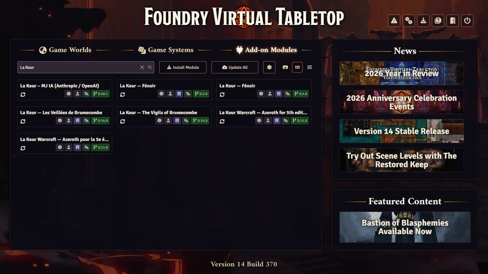

> Prefer to work from source (to contribute)? See the [README](README.en.md#3-from-source).

## 3. The world: ready-made, or your own

### Easiest: the ready-made empty world

A configured world is published with each release: system chosen, modules active, guides and GM journals installed, map of
Réunion in place, AI GM set to the **Chronicler** personality (a narrator who favours dialogue and relationships, well
suited to survival), in **validation** mode and with a **budget of 10 dollars per session**. It holds no game, no player,
no key.

> **Foundry 14 no longer installs a world from its manifest URL**: the **Game Worlds** tab only offers **Create World**.
> The empty world is therefore distributed as an archive to unzip.

1. The system and the modules must be installed (section 2): the world requires them and does not bring them.
2. **Download** `la-kour-fenoir-en.zip` (the English world: same world, translated texts, `lakour-fenoir-en` active) from
   the latest release: <https://github.com/Hogun974/lakour-fenoir/releases/latest> (*Assets* section). The French world is `la-kour-fenoir.zip`.
3. **Find Foundry's data folder**: setup screen › **Configuration** tab › **User Data Path** field. On a hosting service,
   use its file manager.
4. **Unzip** the archive into a new folder `Data/worlds/la-kour-fenoir-en/` (`Data/worlds/la-kour-fenoir/` for the French
   one; the folder name is the world's id): `world.json` must sit directly inside it, not in a subfolder.
5. **Restart Foundry** (the server or the application): it only sees a new world folder at startup. The world
   *La Kour — Fénoir (English)* then appears in **Game Worlds**.

Launch the world: it opens on the login screen with **a single account, Gamemaster, with no password**.

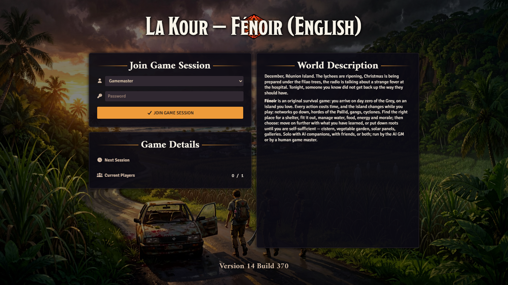

### Or: your own world

1. **Game Worlds › Create World**, system **Fénoir — survie à La Réunion**.
2. In the world, **Settings › Manage Modules**: tick *La Kour — Fénoir (English)* (not the French one too) and *La Kour – MJ IA*.
   Foundry reloads.
3. A **Fénoir** window offers to **install the content**: accept. The player guides, the GM journals (hidden from players)
   and the map of Réunion are imported; everything else (installations, equipment, backgrounds, pregens, bestiary,
   tables…) stays in the *Fénoir — …* compendiums.
4. Optional: in the AI GM console, choose the **Chronicler** personality (otherwise your world starts on the engine's first,
   harsher personality).

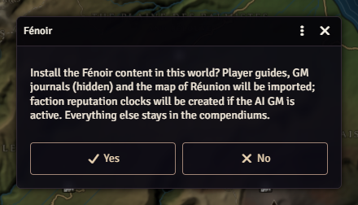

## 4. Before you invite anyone

- **Give the Gamemaster a password** (*Settings › User Management*), then create **one account per player**, each with a
  password. The empty world has none, on purpose.
- Only give the **Assistant GM** role to someone who may know everything: Foundry gives them the same rights as the GM, the
  vault included.
- A look at the system settings (*Settings › Configure Settings › Fénoir*): **Day zero date** (4 December 2026 by default,
  in the middle of the cyclone season), **Creation budget** (10-16: ordinary people, not heroes), **Creation open to
  players**, **Automatic task assignment**, **Holidays follow the game date**. The defaults suit a first game.
- Read, or have your players read, the **Fénoir — Player's guide** journal (the test, condition, time, the shelter); and
  you, the **Opening scenario — Day Zero** GM journal, which offers a ready-to-play first evening.

## 5. Create the survivors

A survivor is an ordinary inhabitant of the island: a **childhood**, a **background** (what they were doing on day zero),
an age, one or two **passions**, character **traits**, sometimes **incapacities**, and ten skills from 0 to 5.

1. Each player logs in. If they have no survivor, the **Create a survivor** window opens by itself; otherwise, the
   **Create a survivor** button at the top of the Actors tab.
2. **Roll**: everything is drawn at random, consistently (skills follow from the childhood, the background and the traits).
3. **Lock** (padlock) what you keep (name, age, childhood, background, traits) and **Roll** the rest again, as often as you
   like; or pick each element from the lists. The budget shown keeps supermen out.
4. **Create this survivor**, leaving **Join the group** ticked.

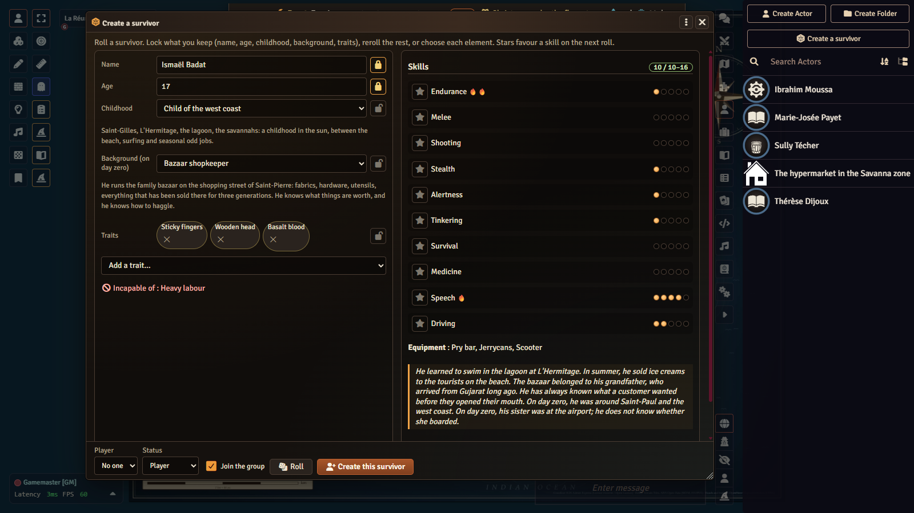

In a hurry? Six **pregens** wait in the *Fénoir — Pregens and NPCs* compendium: drag one into the world and assign it to
the player. The GM can also add a survivor to the group from their window (**Group and recruits › Add to the group** tab).

If the AI GM has a key, it writes each survivor's "Story of…" journal; without AI, the journal is created with its
questions, to be filled in by hand.

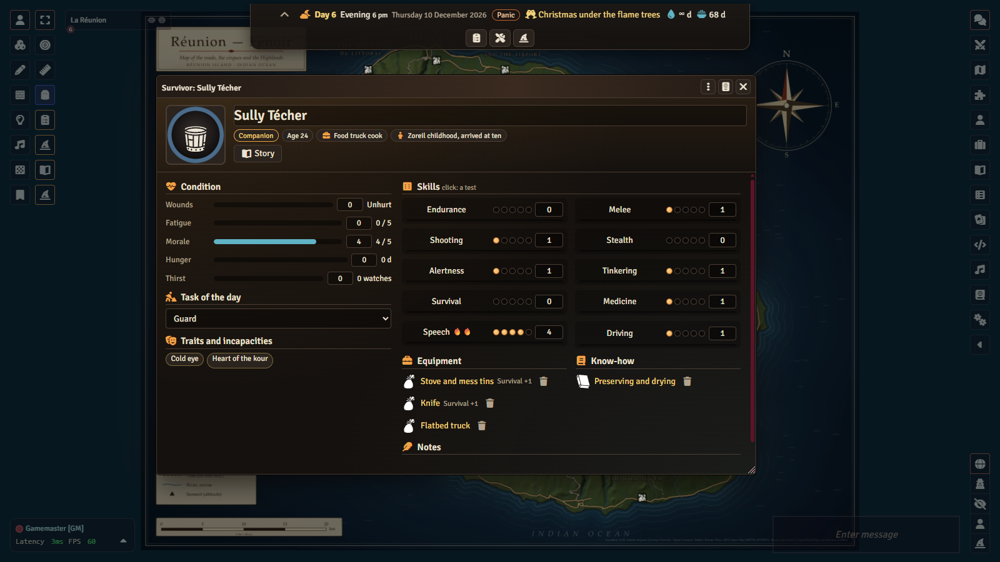

## 6. Start the game

The GM has two buttons in the **token tools** (left bar):

- the **clipboard**: the **Group dashboard** (for everyone);
- the **wizard hat**: **Fénoir — GM window** (for the GM only).

In the GM window, **Game and time › Start the game** tab:

- **Starting region**: where the group meets (for the opening scenario, the region of the meeting place);
- **Test seed**: **leave it empty**; a safe seed is drawn, and nobody can guess how the world will unfold.

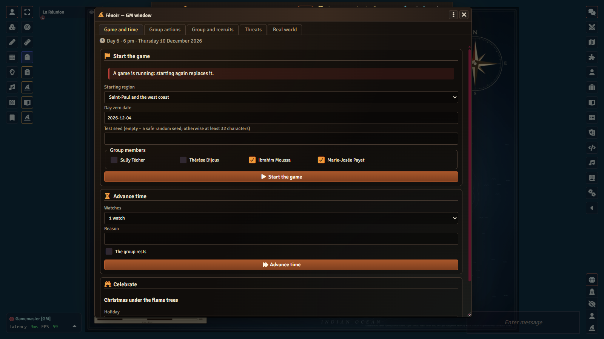

The **survival banner** appears at the top of everyone's screen: day, time of day (morning, afternoon, evening, night),
date, weather, phase of the crisis, stocks in days, alerts.

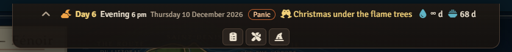

From now on the real world is **sealed in the AI GM vault**, with a key that stays in *your* browser. Remember to
**download the backup key** (*Settings › MJ IA › Vault*) and keep it outside the world, like a password: without it, if your
browser loses the key and the players' shares are not enough, the real world is lost. The engine tutorial explains the
players' key shares.

## 7. The shelter

On day zero everything still works; yet before the first night you need somewhere safe to sleep.

1. **GM window › Group actions › Settle in**: pick a **site** in the region (a Creole house, a school, a mountain lodge, an
   *îlet*…). Each site has its capacity, defence, stealth, water, soil, sun and what you find there on arrival.
2. The **shelter sheet** appears (readable by everyone): stocks and days of stocks, production, defence, stealth,
   visibility, capacity, installations, building works, surroundings, who does what.
3. **Build** (same tab) sets up an **installation**: barricades, water tank, vegetable garden, solar panels… Each costs
   materials, parts, sometimes seeds, and **work shifts** divided by the number of hands, with its prerequisites (a
   know-how, water, soil, another installation): a refusal says what is missing.

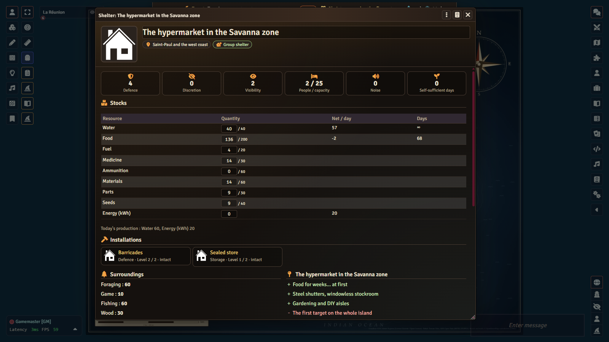

Keep an eye on two gauges. **Noise** (a gunshot, a generator, building work) dies down quickly. **Visibility** (lights at
night, smoke, crops, group size) does not: at 3 people talk about you, at 5 scouts come by, at 7 someone pays you a visit,
at 9 you are attacked.

## 8. The first day: tasks, stocks, expeditions, radio

Time is counted in six-hour **shifts**. **Nothing moves until the GM advances time**: you can talk, plan and hesitate as
long as you like.

### Tasks

In the **Group dashboard**, **The group** tab, the **Who does what** grid crosses survivors and tasks (guard, crops,
livestock, building, workshop, cooking, care, water, fishing, hunting, scavenging, rest, teaching…). Each player clicks
the box of **their** survivor; the request goes to the GM. Below the grid, **What the group lacks** shows which needs are
covered, weak or missing. Companions and recruits take the most useful task by themselves if **Automatic task assignment**
is on.

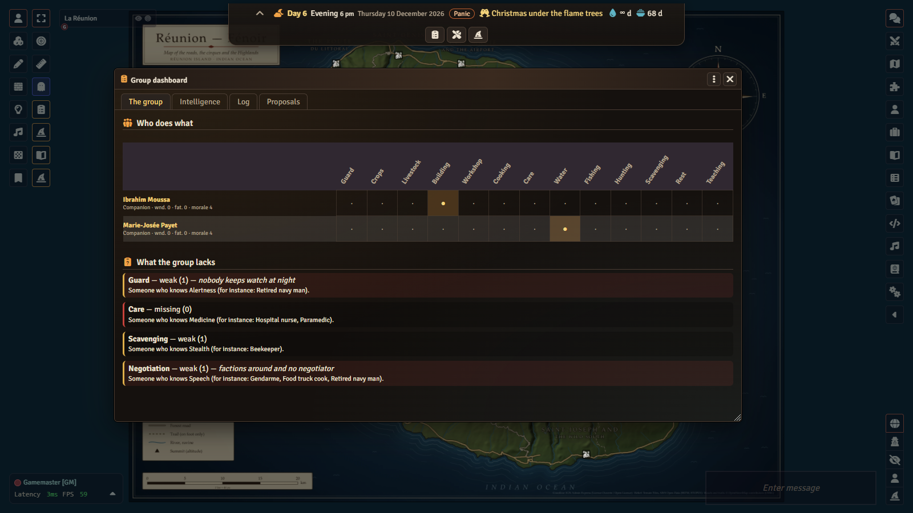

### Stocks

Water, food, energy, materials, parts, medicine… are on the shelter sheet and, in days, in the banner. Every day the
shelter produces, the group eats and drinks, and food **spoils** (5% a day without airtight storage or a dryer: the humid
heat rots everything). The GM corrects a stock by hand with **Group actions › Adjust stocks**.

### Expeditions

In **Group actions**, the GM has those who go out act:

- **Scavenge** a place (one shift): something to fill the stocks, at the price of noise and bad encounters;
- **Explore** a region (one or two shifts): fresh **intelligence** about it;
- **Travel** to a neighbouring region, depending on the road and the vehicle; **Move out** is travelling with the whole
  shelter.

Players can **propose** an action to the GM: the **Proposals** tab of the dashboard.

When an action calls for a test, a card arrives in the chat with a **Roll** button for the player concerned: as many d6 as
the skill + 1, each 5 or 6 is a success. You may **Push** once (reroll the failures for 1 fatigue).

### Intelligence and the radio

What the group knows about a region is **dated intelligence** (the **Intelligence** tab of the dashboard): *seen* with
their own eyes on a given day, heard on the *radio*, or mere *rumour*. The world changes while you are away. As long as the
phone works in the region, news travels; once it goes down, only a **radio** (a portable one found while scavenging, or the
shelter's radio installation) brings news from the island: outages, cyclone alerts, calls from the factions. Players only
see what they know; the GM also sees the **Real world** (the tab of that name; do not show it on a shared screen).

### Getting through the day

**Game and time › Advance time**: one shift, one day or one week. Each shift the infection progresses, thirst weighs, noise
dies down; each day the shelter produces, the world is simulated and its events happen. The **threats of the day**
(**Threats** tab) only happen if the GM resolves them: **Assault** or **Set aside**.

Your first day is a success if, on the evening of day zero, everyone sleeps under a roof, with water for tomorrow and
someone on watch. What comes next (recruits, festivals, workshop, diseases, moving out) is in the Player's guide and the
**Life in camp** journal.

## 9. The AI GM as narrator (optional)

The `lakour-mj-ia` module can run the game: it narrates, plays the NPCs, asks for tests and has the group act with the same
rules as the GM window (`survie_*` tools). It always keeps what the players know apart from what only the GM knows. You stay
in control:

- in **validation** mode (the default), every action that changes the world waits for your approval;
- a **per-session budget** (10 dollars by default) stops it;
- the **dummy** provider lets you try everything without a key or a cost.

The API key (Claude or OpenAI) is set in your browser, never in the world. Everything is explained step by step in the
**engine tutorial**: [TUTORIAL.md](https://github.com/Hogun974/lakour-mj-ia/blob/principale/TUTORIAL.md)
([en français](https://github.com/Hogun974/lakour-mj-ia/blob/principale/TUTORIEL.md)). For Fénoir, one thing to know: start
the game (section 6), then the AI GM session; it reads Fénoir's state and takes over. The AI GM's instructions are written
in French; it can narrate in English.

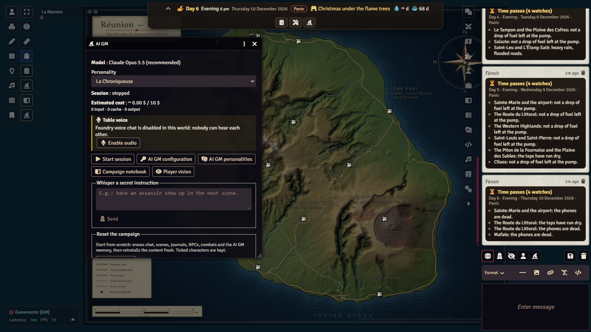

### AI companions, cost and autopilot

- **Companions model**: *Settings › MJ IA › AI companions model* is a list. *Default* (empty) takes a cheap model from
  the active provider (Claude Haiku 5.5, or OpenAI's cheapest); a model from the other provider falls back to that
  default.
- **Cost**: the AI GM console shows the current session's estimated cost (narrator, companions, voice, transcription)
  against the budget; reopen it to see it up to date. Once the budget is reached, the narrator stops and warns you, and
  the companions go on in simple mode, without AI.
- **Autopilot**: when no connected player has their survivor's token on the active scene and AI companions are there,
  the AI GM can carry on alone (it resolves their decisions with the `survie_*` tools, which make time pass). It needs
  *Autonomous* autonomy: in approval mode, the empty world's, you only get a notice. The autopilot hands control back
  when a player returns, stops at the budget or after 60 steps (adjustable), and the console stops or restarts it.

In detail: [README, "What engine 0.44.1 brings to the table"](README.en.md#what-engine-0441-brings-to-the-table).

## 10. Voice and the TURN audio relay (optional)

Foundry has built-in audio and video chat (*Settings › Configure Audio/Video*). Browsers talk to each other directly;
behind some home routers or company networks the connection fails and you need a **relay server (TURN)**. If voice works
for everyone, leave it alone.

Otherwise, enter the address of your TURN relay and its credentials in the server tab of that window. A few rules:

- these credentials are **yours**: none is provided with Fénoir, and never publish them (not in a repository, not in a
  screenshot, not in the chat);
- the published empty world holds **no** audio/video setting: the tool that builds it removes that setting on purpose;
- Foundry's documentation (*Audio/Video Chat*) describes the options and the ports to open.

The AI GM's voice (speech synthesis, listening) is another matter, covered in the engine tutorial.

### Players' cameras

With Foundry's video, open the AI GM console (wizard hat): its **Players' cameras** block says whether they are allowed
or cut.

1. The world is audio only? **Add video** switches it to "Audio & Video" (the TURN relay server is kept); everyone
   reloads the page when Foundry offers it, then picks a camera in *Configure Audio/Video › Client*.
2. Some players are listed under "No camera permission"? **Give players the camera** grants the "Broadcast Video"
   permission to the Player role.
3. **Cut the cameras** and **Allow the cameras** toggle the *Players' cameras allowed* setting (also in *Settings › MJ
   IA*, checked by default). Once cut, no player's camera is shown to anyone, even if a player switches theirs back on
   from their browser console; yours stays, and **microphones are left alone**.

## 11. Troubleshooting

| Symptom | Likely cause | What to do |
|---|---|---|
| When installing the world, Foundry says a dependency cannot be found. | One of the three packages does not install from its manifest. | Install the system and both modules first (section 2), then the world. |
| "This world does not use the La Kour Survie system". | World created with another system. | Create a world with the *Fénoir — survie à La Réunion* system. |
| A "content" error notification on load. | The content module and the system are not compatible versions. | Update the system and the module (*Update* in Foundry's setup). |
| Duplicate texts, odd compendiums. | `lakour-fenoir` and `lakour-fenoir-en` active together. | Keep only one (*Manage Modules*). |
| The invitation to install the content does not appear. | Content already installed, or you are not the active GM. | It only appears to the active GM, once per version. To run it again: browser console (F12), `game.modules.get("lakour-fenoir-en").api.installer()` (or `"lakour-fenoir"` for the French module). |
| "You are not the active GM: only the active GM writes Fénoir's state." | Two GM accounts connected. | Only one GM writes the state; disconnect the other or let them do it. |
| "The world is not open in this browser: nothing is written." | The vault is closed in this browser (another computer, cleared data). | **Reopen the vault** in the GM window; otherwise the shares of connected players, or the backup key (*Settings › MJ IA › Vault*). |
| A permanent warning that players can read the state of the world. | The AI GM module is not active. | Enable *La Kour – MJ IA* (no AI key needed). |
| No **Create a survivor** button for a player. | **Creation open to players** setting turned off. | Turn it on, or create the survivor yourself and assign it. |
| No banner at the top of the screen. | **Survival banner** client setting turned off. | *Settings › Configure Settings › Fénoir*. |
| The AI GM no longer answers. | Session budget reached, or an action waiting for approval. | Check the AI GM console; raise the budget or approve. Details in the engine tutorial. |
| Voice does not get through between two players. | A network that blocks direct connections. | Section 10: a TURN relay. |
| Players' cameras are not shown. | World in audio only, cameras cut by the setting, or players without the "Broadcast Video" permission. | AI GM console, **Players' cameras** block: *Add video*, *Allow the cameras* or *Give players the camera* (section 10). |
| The autopilot does not start. | Autonomy set to approval, autopilot setting unchecked, or a connected player still has a visible token on the active scene. | Set autonomy to *Autonomous*; an offline player does not count (section 9). |

Another problem? Open an [issue](https://github.com/Hogun974/lakour-fenoir/issues) with your Foundry version, the versions of
the three packages, and what the browser console (F12) says. Never paste an API key or a password.
