# Tutoriel — de zéro à la première journée de survie

*Installer Fénoir dans Foundry VTT, créer ses survivants, trouver un abri et tenir la première journée. Comptez une heure,
installation comprise.*

[English version](TUTORIAL.md) · [README](README.md) · [Le tutoriel du moteur MJ IA](https://github.com/Hogun974/lakour-mj-ia/blob/principale/TUTORIEL.md)

Ce tutoriel suppose que vous n'avez jamais entendu parler de Fénoir. Il suit l'ordre d'une vraie première soirée : installer,
préparer le monde, créer les survivants, démarrer, s'abriter, jouer la journée, puis (si vous le voulez) confier la narration
au MJ IA. Les règles complètes sont dans le jeu lui-même (journal **Fénoir — Guide du joueur**) ; ici, on ne garde que ce qu'il
faut pour commencer.

> Les captures d'écran citées (`docs/captures/…`) montrent l'interface en français ; leur liste est dans
> [`docs/captures/LISEZ-MOI.md`](docs/captures/LISEZ-MOI.md).

## Sommaire

1. [Ce qu'il faut](#1-ce-quil-faut)
2. [Installer le système, le module et le moteur](#2-installer-le-système-le-module-et-le-moteur)
3. [Le monde : vierge tout prêt, ou fait main](#3-le-monde--vierge-tout-prêt-ou-fait-main)
4. [Avant d'inviter qui que ce soit](#4-avant-dinviter-qui-que-ce-soit)
5. [Créer les survivants](#5-créer-les-survivants)
6. [Démarrer la partie](#6-démarrer-la-partie)
7. [L'abri](#7-labri)
8. [La première journée : tâches, stocks, expéditions, radio](#8-la-première-journée--tâches-stocks-expéditions-radio)
9. [Le MJ IA comme narrateur (facultatif)](#9-le-mj-ia-comme-narrateur-facultatif)
10. [La voix et le relais audio TURN (facultatif)](#10-la-voix-et-le-relais-audio-turn-facultatif)
11. [Dépannage](#11-dépannage)

## 1. Ce qu'il faut

- **Foundry VTT v14**, avec une licence. Fénoir est vérifié avec la **14.370** ; une version 14 plus récente devrait
  convenir, une v13 non.
- Un serveur Foundry que vos joueurs peuvent joindre (chez vous avec le port ouvert, ou chez un hébergeur). Pour un essai
  seul, Foundry sur votre ordinateur suffit.
- **Rien à acheter** : le système de jeu, le contenu et le moteur MJ IA sont gratuits et fournis ici.
- Facultatif : une clé d'API Claude (Anthropic) ou OpenAI pour le MJ IA. **Sans clé, tout le jeu marche** : vous menez la
  partie vous-même, et le moteur ne contacte personne.
- Facultatif : le module de traduction française de l'interface de Foundry (`fr-core`), si votre Foundry est en anglais et
  que vous voulez ses menus en français. Le monde vierge l'active s'il est installé, et l'ignore sinon.

Fénoir tient en **trois paquets** à installer, plus un monde :

| Paquet | Identifiant | Rôle |
|---|---|---|
| Système *Fénoir — survie à La Réunion* | `lakour-survie` | les règles, les fiches, le temps, la simulation du monde |
| Module *La Kour — Fénoir* | `lakour-fenoir` (français) ou `lakour-fenoir-en` (anglais) | le contenu : l'île, les abris, les installations, les guides |
| Module *La Kour – MJ IA* | `lakour-mj-ia` | le coffre qui garde le monde réel secret, et le MJ IA si vous le voulez |

Le module MJ IA est **nécessaire même sans IA** : c'est lui qui chiffre l'état réel du monde (hordes, réserves, coupures…)
pour que les joueurs ne puissent pas le lire dans leur navigateur. Sans lui, le jeu tourne, mais le MJ est prévenu en
permanence que les joueurs peuvent lire l'état du monde.

## 2. Installer le système, le module et le moteur

Tout s'installe depuis l'écran de configuration de Foundry (avant d'entrer dans un monde), en collant une **URL de
manifeste**. Foundry retrouvera ensuite seul les mises à jour.

**Le système.** Onglet **Systèmes de jeu › Installer un système**, champ *URL du manifeste* :

```
https://github.com/Hogun974/lakour-fenoir/releases/latest/download/system.json
```

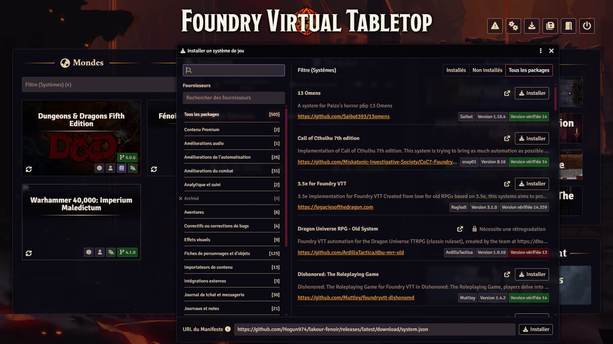

**Le module de contenu.** Onglet **Modules complémentaires › Installer un module**, même champ :

```
https://github.com/Hogun974/lakour-fenoir/releases/latest/download/module.json
```

Pour jouer **en anglais**, installez à la place (ou en plus) le module anglais ; il a les mêmes documents et les mêmes
identifiants, **un seul des deux doit être actif** dans un monde :

```
https://github.com/Hogun974/lakour-fenoir/releases/latest/download/lakour-fenoir-en.json
```

**Le moteur MJ IA.** Encore **Installer un module** :

```
https://github.com/Hogun974/lakour-mj-ia/releases/latest/download/module.json
```

À la fin, vous devez voir *Fénoir — survie à La Réunion* dans les systèmes, *La Kour — Fénoir* (ou *La Kour — Fénoir
(English)* pour le module anglais) et *La Kour – MJ IA* dans les modules.

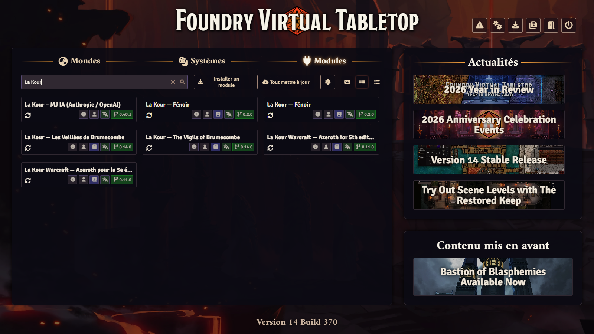

> Vous préférez partir des sources (pour contribuer) ? La marche à suivre est dans le [README](README.md#3-depuis-les-sources).

## 3. Le monde : vierge tout prêt, ou fait main

### Le plus simple : le monde vierge

Un monde déjà configuré est publié avec chaque version : système choisi, modules actifs, guides et journaux du MJ installés,
carte de La Réunion en place, MJ IA réglé sur la personnalité **La Chroniqueuse** (une narratrice qui privilégie les
dialogues et les relations, adaptée à la survie), en mode **validation** et avec un **budget de 10 $ par séance**. Il ne
contient aucune partie, aucun joueur, aucune clé.

> **Foundry 14 n'installe plus de monde par son URL de manifeste** : l'onglet **Mondes de jeu** ne propose que **Créer un
> monde**. Le monde vierge se distribue donc en archive à décompresser.

1. Le système et les modules doivent être installés (section 2) : le monde les exige et ne les apporte pas.
2. **Téléchargez** `la-kour-fenoir.zip` dans la dernière version publiée : <https://github.com/Hogun974/lakour-fenoir/releases/latest> (rubrique
   *Assets*). Pour le **monde anglais** (même monde, textes traduits, module `lakour-fenoir-en` actif) :
   `la-kour-fenoir-en.zip`.
3. **Trouvez le dossier de données de Foundry** : écran de configuration › onglet **Configuration** › champ **Chemin des
   données** (*User Data Path*). Sur un hébergeur, passez par son gestionnaire de fichiers.
4. **Décompressez** l'archive dans un nouveau dossier `Data/worlds/la-kour-fenoir/` (ou `Data/worlds/la-kour-fenoir-en/`
   pour l'anglais ; le nom du dossier est l'identifiant du monde) : `world.json` doit se trouver directement dedans, pas
   dans un sous-dossier.
5. **Redémarrez Foundry** (le serveur ou l'application) : il ne voit un nouveau dossier de monde qu'au démarrage. Le monde
   *La Kour — Fénoir* apparaît alors dans **Mondes de jeu**.

Lancez le monde ; il s'ouvre sur l'écran de connexion avec **un seul compte, Gamemaster, sans mot de passe**.

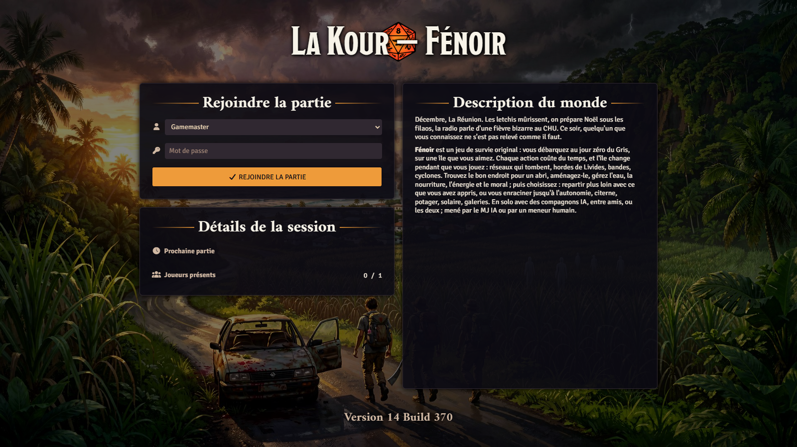

### Ou bien : votre propre monde

1. **Mondes de jeu › Créer un monde**, système **Fénoir — survie à La Réunion**.
2. Dans le monde, **Réglages › Gérer les modules** : cochez *La Kour — Fénoir* (ou sa version anglaise, pas les deux) et
   *La Kour – MJ IA*. Foundry recharge.
3. Une fenêtre **Fénoir** propose d'**installer le contenu** : acceptez. Les guides des joueurs, les journaux du MJ (cachés
   aux joueurs) et la carte de La Réunion sont importés ; tout le reste (installations, équipement, passés, prétirés,
   bestiaire, tables…) reste dans les compendiums *Fénoir — …*.
4. Facultatif : dans la console du MJ IA, choisissez la personnalité **La Chroniqueuse** (votre monde part sinon sur la
   première personnalité du moteur, plus dure).

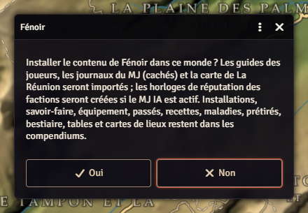

## 4. Avant d'inviter qui que ce soit

- **Donnez un mot de passe au Gamemaster** (*Réglages › Configuration des joueurs*), puis créez **un compte par joueur**, avec son
  mot de passe. Le monde vierge n'en a aucun, exprès.
- Ne donnez le rôle **MJ-assistant** qu'à quelqu'un qui peut tout savoir : Foundry lui donne les mêmes droits qu'au MJ,
  coffre compris.
- Un coup d'œil aux réglages du système (*Réglages › Configurer les paramètres › Fénoir*) : **Date du jour zéro**
  (4 décembre 2026 par défaut, en pleine saison des cyclones), **Budget de création** (10-16 : des gens ordinaires, pas des
  héros), **Création ouverte aux joueurs**, **Répartition automatique des tâches**, **Les fêtes suivent la date de jeu**.
  Les valeurs par défaut conviennent pour une première partie.
- Lisez, ou faites lire, le journal **Fénoir — Guide du joueur** (le test, l'état, le temps, l'abri) ; vous, le journal
  **Scénario d'ouverture — Jour zéro**, qui propose une première soirée clé en main.

## 5. Créer les survivants

Un survivant, c'est un habitant ordinaire de l'île : une **enfance**, un **passé** (ce qu'il faisait le jour zéro), un âge,
une ou deux **passions**, des **traits** de caractère, parfois des **incapacités**, et dix compétences de 0 à 5.

1. Chaque joueur se connecte. S'il n'a pas de survivant, la fenêtre **Créer un survivant** s'ouvre seule ; sinon, bouton
   **Créer un survivant** en haut de l'onglet des acteurs.
2. **Tirer** : tout est tiré au sort de façon cohérente (les compétences découlent de l'enfance, du passé et des traits).
3. **Verrouiller** (cadenas) ce qu'on garde (nom, âge, enfance, passé, traits) et **tirer** à nouveau le reste, autant de
   fois qu'on veut ; ou choisir chaque élément dans les listes. Le budget affiché évite les surhommes.
4. **Créer ce survivant**, en laissant **Rejoindre le groupe** coché.

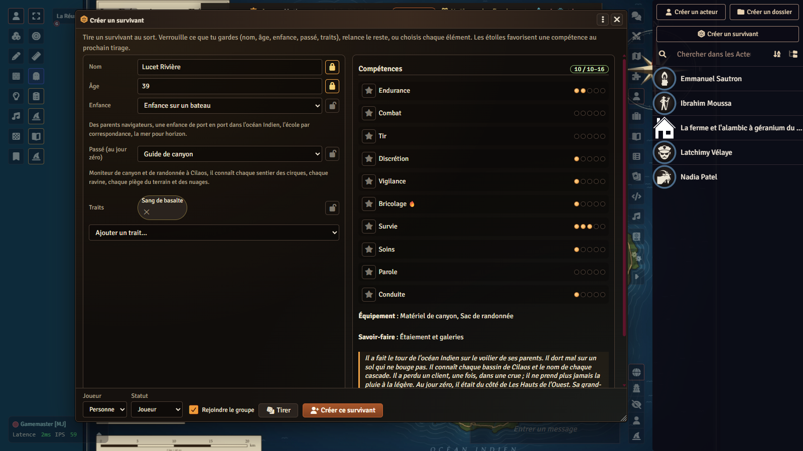

Pressé ? Six **prétirés** attendent dans le compendium *Fénoir — Prétirés et PNJ* : glissez-en un dans le monde et
attribuez-le au joueur. Le MJ peut aussi ajouter un survivant au groupe depuis sa fenêtre (onglet **Groupe et recrues ›
Ajouter au groupe**).

Si le MJ IA a une clé, il écrit le journal « Histoire de… » de chaque survivant ; sans IA, le journal est créé avec ses
questions, à remplir à la main.

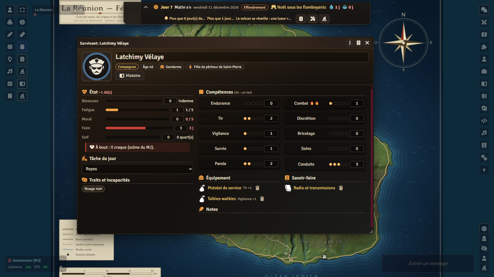

## 6. Démarrer la partie

Le MJ a deux boutons dans les **outils des jetons** (barre de gauche) :

- le **presse-papiers** : le **Tableau de bord du groupe** (pour tout le monde) ;
- le **chapeau de magicien** : **Fénoir — fenêtre du MJ** (pour le MJ seul).

Dans la fenêtre du MJ, onglet **Partie et temps › Démarrer la partie** :

- **Région de départ** : là où le groupe se retrouve (pour le scénario d'ouverture, celle du lieu de rendez-vous) ;
- **Graine d'essai** : **laissez vide** ; une graine sûre est tirée, et personne ne peut deviner la suite du monde.

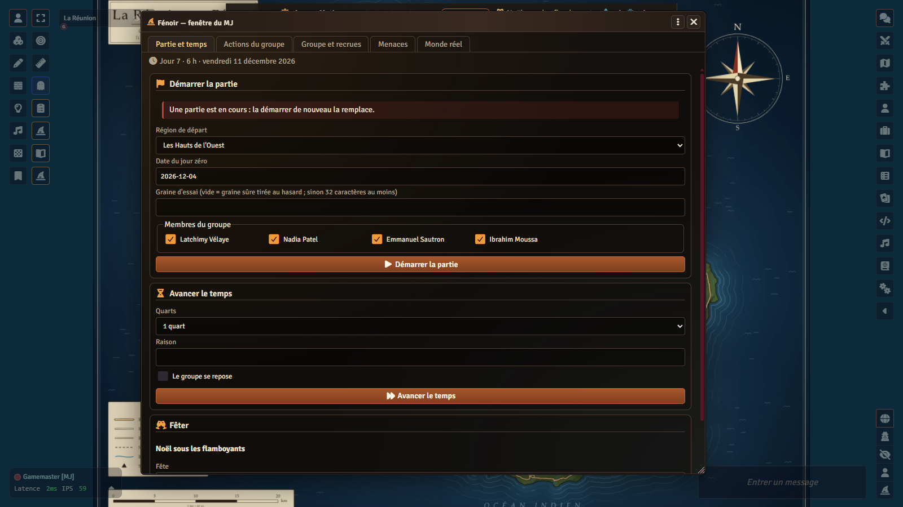

Le **bandeau de survie** apparaît en haut de l'écran de chacun : jour, moment (matin, après-midi, soir, nuit), date, météo,
phase de la crise, stocks en jours, alertes.

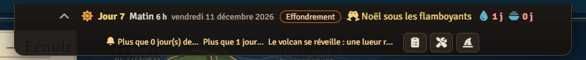

À ce moment, le monde réel est **scellé dans le coffre** du MJ IA, avec une clé qui reste dans *votre* navigateur. Pensez à
**télécharger la clé de secours** (*Réglages › MJ IA › Coffre*) et à la garder hors du monde, comme un mot de passe : sans
elle, si votre navigateur perd la clé et que les parts des joueurs ne suffisent pas, le monde réel est perdu. Le tutoriel du
moteur explique les parts de clé des joueurs.

## 7. L'abri

Le jour zéro, tout marche encore ; il faut pourtant, avant la première nuit, un endroit où dormir à l'abri.

1. **Fenêtre du MJ › Actions du groupe › S'installer** : choisissez un **site** de la région (une case créole, un collège, un
   gîte, un îlet…). Chaque site a sa capacité, sa défense, sa discrétion, son eau, son sol, son soleil et ce qu'on y trouve en
   arrivant.
2. La **fiche d'abri** apparaît (lisible de tous) : stocks et jours de stocks, production, défense, discrétion, visibilité,
   capacité, installations, chantiers, alentours, qui fait quoi.
3. **Construire** (même onglet) pose une **installation** : barricades, citerne, potager, panneaux… Chacune coûte des
   matériaux, des pièces, parfois des graines, et des **quarts de travail** divisés par le nombre de bras, avec ses
   prérequis (un savoir-faire, de l'eau, du sol, une autre installation) : un refus dit ce qui manque.

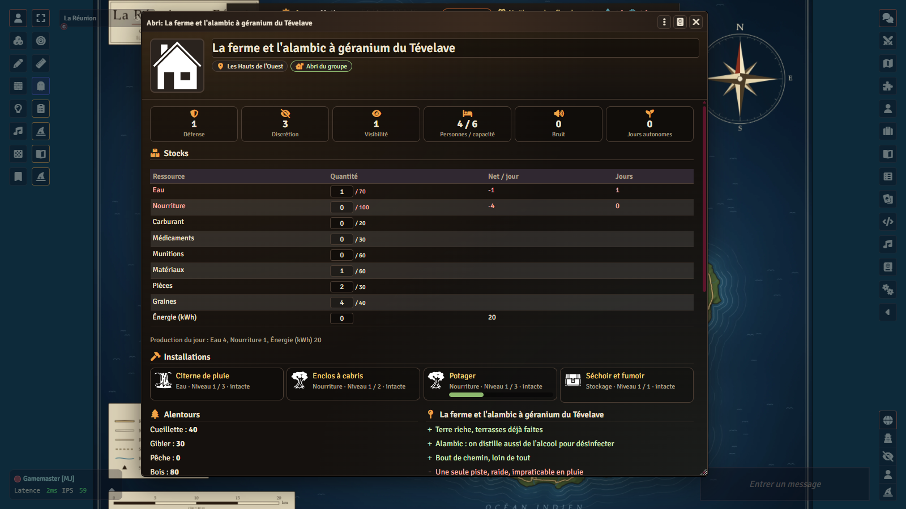

Retenez deux jauges. Le **bruit** (coup de feu, groupe électrogène, chantier) retombe vite. La **visibilité** (lumières la
nuit, fumée, cultures, taille du groupe) ne retombe pas : à 3 on parle de vous, à 5 des éclaireurs passent, à 7 on vous rend
visite, à 9 on vous attaque.

## 8. La première journée : tâches, stocks, expéditions, radio

Le temps se compte en **quarts** de six heures. **Rien n'avance tant que le MJ ne fait pas avancer le temps** : on peut
discuter, préparer, hésiter aussi longtemps qu'on veut.

### Les tâches

Dans le **Tableau de bord du groupe**, onglet **Le groupe**, la grille **Qui fait quoi** croise les survivants et les tâches
(garde, cultures, élevage, chantier, atelier, cuisine, soins, eau, pêche, chasse, fouille, repos, enseigner…). Chaque joueur
clique la case de **son** survivant ; la demande part au MJ. Sous la grille, **Ce qui manque au groupe** dit quels besoins
sont couverts, faibles ou manquants. Les compagnons et les recrues prennent seuls la tâche la plus utile si la
**Répartition automatique** est active.

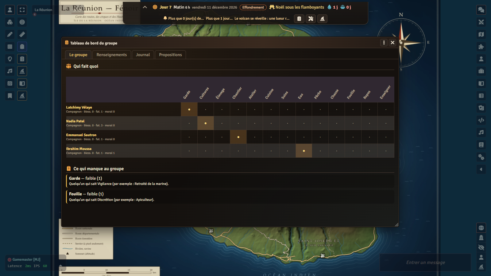

### Les stocks

Eau, nourriture, énergie, matériaux, pièces, médicaments… sont sur la fiche d'abri et, en jours, dans le bandeau. Chaque
jour, l'abri produit, le groupe mange et boit, et la nourriture **se gâte** (5 % par jour sans réserve étanche ni séchoir : la
chaleur humide pourrit tout). Le MJ corrige un stock à la main par **Actions du groupe › Ajuster les stocks**.

### Les expéditions

Dans **Actions du groupe**, le MJ fait agir ceux qui partent :

- **Fouiller** un lieu (un quart) : de quoi remplir les stocks, au prix de bruit et de mauvaises rencontres ;
- **Explorer** une région (un ou deux quarts) : des **renseignements** frais sur elle ;
- **Voyager** vers une région voisine, selon la route et le véhicule ; **Déménager**, c'est voyager avec tout l'abri.

Les joueurs peuvent **proposer** une action au MJ : onglet **Propositions** du tableau de bord.

Quand une action demande un test, une carte arrive dans le chat avec un bouton **Lancer** chez le joueur concerné : autant de
d6 que la compétence + 1, chaque 5 ou 6 est un succès. On peut **Forcer** une fois (relancer les échecs contre 1 fatigue).

### Les renseignements et la radio

Ce que le groupe sait d'une région est un **renseignement daté** (onglet **Renseignements** du tableau de bord) : *vu* de ses
yeux tel jour, entendu à la *radio*, ou simple *rumeur*. Le monde change pendant qu'on n'y est pas. Tant que le téléphone
marche dans la région, les nouvelles circulent ; quand il tombe, seule une **radio** (portative, trouvée en fouillant, ou
l'installation radio de l'abri) apporte les nouvelles de l'île : coupures, alertes cyclone, appels des factions. Les joueurs
ne voient que ce qu'ils savent ; le MJ voit en plus le **Monde réel** (onglet du même nom, à ne pas montrer à l'écran).

### Faire passer la journée

**Partie et temps › Avancer le temps** : un quart, un jour ou une semaine. À chaque quart l'infection progresse, la soif pèse,
le bruit retombe ; à chaque jour l'abri produit, le monde se simule et ses événements tombent. Les **menaces du jour**
(onglet **Menaces**) n'arrivent que si le MJ les résout : **Assaut** ou **Écarter**.

Votre première journée est réussie si, au soir du jour zéro, tout le monde dort sous un toit, avec de l'eau pour le
lendemain et quelqu'un de garde. La suite (recrues, fêtes, atelier, maladies, déménagement) est dans le Guide du joueur et
le journal **La vie au camp**.

## 9. Le MJ IA comme narrateur (facultatif)

Le module `lakour-mj-ia` peut mener la partie : il raconte, joue les PNJ, demande les tests et fait agir le groupe avec les
mêmes règles que la fenêtre du MJ (outils `survie_*`). Il sépare toujours ce que les joueurs savent de ce que le MJ seul
sait. Vous gardez la main :

- en mode **validation** (par défaut), chaque action qui change le monde attend votre accord ;
- un **budget par séance** (10 $ par défaut) l'arrête ;
- le fournisseur **factice** permet de tout essayer sans clé ni coût.

La clé d'API (Claude ou OpenAI) se règle dans votre navigateur, jamais dans le monde. Tout est expliqué pas à pas dans le
**tutoriel du moteur** : [TUTORIEL.md](https://github.com/Hogun974/lakour-mj-ia/blob/principale/TUTORIEL.md)
([in English](https://github.com/Hogun974/lakour-mj-ia/blob/principale/TUTORIAL.md)). Pour Fénoir, une seule chose à
savoir : démarrez la partie (section 6), puis la séance du MJ IA ; il lit l'état de Fénoir et prend la suite.

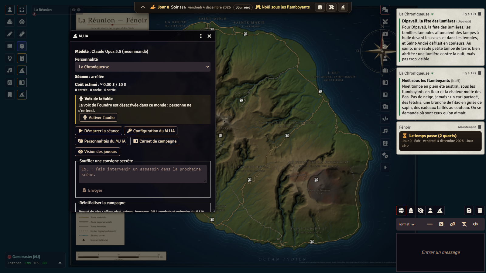

## 10. La voix et le relais audio TURN (facultatif)

Foundry a un chat audio et vidéo intégré (*Réglages › Configurer l'audio/vidéo*). Les navigateurs s'y parlent directement ;
derrière certaines box ou réseaux d'entreprise, la connexion échoue et il faut un **serveur relais (TURN)**. Si la voix
passe chez tout le monde, ne touchez à rien.

Sinon, renseignez dans l'onglet serveur de cette fenêtre l'adresse de votre relais TURN et ses identifiants. Quelques règles :

- ces identifiants sont **les vôtres** : aucun n'est fourni avec Fénoir, et ne les publiez jamais (ni dans un dépôt, ni
  dans une capture, ni dans le chat) ;
- le monde vierge publié ne contient **aucun** réglage audio/vidéo : l'outil qui le fabrique retire exprès ce réglage ;
- la documentation de Foundry (*Audio/Video Chat*) décrit les options et les ports à ouvrir.

La voix du MJ IA (synthèse vocale, écoute) est une autre affaire, décrite dans le tutoriel du moteur.

## 11. Dépannage

| Symptôme | Cause probable | Que faire |
|---|---|---|
| À l'installation du monde, Foundry dit qu'une dépendance est introuvable. | Un des trois paquets ne s'installe pas par son manifeste. | Installez d'abord le système et les deux modules (section 2), puis le monde. |
| « Ce monde n'utilise pas le système La Kour Survie ». | Monde créé avec un autre système. | Créez un monde avec le système *Fénoir — survie à La Réunion*. |
| Notification d'erreur « contenu » au chargement. | Le module de contenu et le système ne sont pas de versions compatibles. | Mettez à jour le système et le module (*Mettre à jour* dans la configuration de Foundry). |
| Textes en double, compendiums bizarres. | `lakour-fenoir` et `lakour-fenoir-en` actifs ensemble. | N'en gardez qu'un (*Gérer les modules*). |
| L'invitation à installer le contenu n'apparaît pas. | Contenu déjà installé, ou vous n'êtes pas le MJ actif. | Elle n'apparaît qu'au MJ actif, une fois par version. Pour la relancer : console du navigateur (F12), `game.modules.get("lakour-fenoir").api.installer()`. |
| « Tu n'es pas le MJ actif : seul le MJ actif écrit l'état de Fénoir. » | Deux comptes MJ connectés. | Un seul MJ écrit l'état ; déconnectez l'autre ou laissez-le faire. |
| « Le monde n'est pas ouvert dans ce navigateur : rien ne s'écrit. » | Le coffre est fermé dans ce navigateur (autre ordinateur, données effacées). | **Rouvrir le coffre** dans la fenêtre du MJ ; sinon les parts des joueurs connectés, ou la clé de secours (*Réglages › MJ IA › Coffre*). |
| Avertissement permanent « les joueurs peuvent lire l'état du monde ». | Le module MJ IA n'est pas actif. | Activez *La Kour – MJ IA* (aucune clé d'IA n'est nécessaire). |
| Pas de bouton **Créer un survivant** chez un joueur. | Réglage **Création ouverte aux joueurs** désactivé. | Activez-le, ou créez le survivant vous-même et attribuez-le. |
| Pas de bandeau en haut de l'écran. | Réglage client **Bandeau de survie** désactivé. | *Réglages › Configurer les paramètres › Fénoir*. |
| Le MJ IA ne répond plus. | Budget de la séance atteint, ou action en attente de validation. | Voir la console du MJ IA ; augmentez le budget ou validez. Détails dans le tutoriel du moteur. |
| La voix ne passe pas entre deux joueurs. | Réseau qui bloque les connexions directes. | Section 10 : un relais TURN. |

Un autre problème ? Ouvrez une [issue](https://github.com/Hogun974/lakour-fenoir/issues) en décrivant votre version de Foundry,
celles des trois paquets, et ce que dit la console du navigateur (F12). Ne collez jamais de clé d'API ni de mot de passe.
